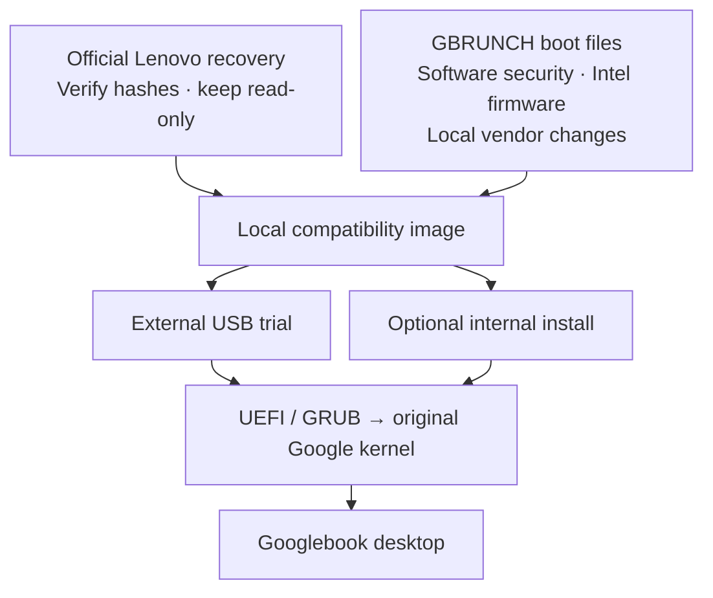

# GBRUNCH

GBRUNCH is an experimental project to run Googlebook OS on ordinary Intel UEFI laptops. It builds a local bootable image from an **official Lenovo Googlebook recovery**, preserving Google's original system partitions and adding a separate compatibility layer.

> **Experimental: things can go wrong.** Boot failures, crashes, broken hardware support and data loss are possible. Writing the ISO erases the selected drive, and choosing the wrong disk can destroy your existing data. Back up anything important and start with a dedicated external drive before attempting internal installation.

## TL;DR

- **GBRUNCH brings Googlebook OS to Intel laptops using a locally built compatibility layer.**
- **Only one HP Envy x360 15-fe1xxx / Core Ultra 7 155U has been physically tested.** The desktop, graphics and Wi-Fi work; **webcam and sound do not work yet**.
- **Toolbox v0.3** provides a Linux USB environment to download the official recovery, build locally, try Googlebook and collect logs. Use a dedicated **64 GB or larger USB drive or USB SSD**.
- Other laptops can use the explicit experimental boot entry, but compatibility is unverified. Contributions and hardware reports are welcome.
- **This is experimental.** Back up important data; boot failures and disk-writing mistakes can cause data loss. Internal installation has not been physically validated.

Googlebook OS has reached the home screen on the tested HP. That is the only laptop currently available for physical testing. The project is open for collaboration to expand hardware support.

Googlebook OS is proprietary. **This repository contains no Google recovery image, original Google kernel/module/ramdisk, derived Google vendor/policy image, account data, or raw device logs.** Download recovery directly from Google and build locally. Do not upload generated recovery-derived images here.

## Status

| Component | Evidence / current limit |
| --- | --- |
| External Googlebook desktop | Booted on the HP described below; improved graphics/responsiveness and working Wi-Fi confirmed in physical testing |
| Official recovery import | Full pinned Lenovo recovery downloaded, hashed, inspected and assembled locally |
| Linux toolbox | Debian 13 / XFCE, browser, terminal, NetworkManager, hardware reports and persistent logs; UEFI desktop demonstrated in QEMU |
| Same-drive Googlebook trial | Production copy/readback and GPT rollback tested in QEMU; cold UEFI handoff reached the original Google kernel; complete Android boot in this new layout not physically confirmed |
| Internal dual boot | Production installer tested against dummy Windows/system contents in QEMU; preserves existing partition bytes and boot priority; physical internal Android boot not confirmed |
| Automatic Google updates | Not implemented or validated |
| Other laptops | Untested; default entry is HP/QEMU-gated, with an explicit experimental entry in new source builds |
| Webcam and sound | **Not working yet on the tested HP** |
| Bluetooth, sensors, sleep, media acceleration | Full Android functionality has not been established |

Toolbox **v0.3** includes persistent USB storage, the local recovery builder and an explicit experimental boot entry for other laptops. It requires a dedicated USB drive or USB SSD of **64 GB or larger**.

## How it works

1. The builder imports the pinned Lenovo **Ruby** recovery, build **16452207 / CL3B.260622.271.R1**, from Google's official infrastructure. It checks the ZIP and extracted image hashes and retains those originals.
2. A sparse local QCOW2 view references that unchanged recovery using a relative backing path. The compatibility assembly adds independent boot/compatibility/vendor/log partitions. Google's original non-EFI partitions remain backed by the original recovery; the boot environment uses locally assembled files and a derived vendor view.
3. GNU GRUB starts Google's original x86-64 Android kernel and matching modules. The compatibility init/boot configuration replaces or masks hardware services that expect the original Lenovo board, supplies software security services and applies the scoped vendor/SELinux changes needed by this port.
4. On the HP, the stock Xe kernel driver and Google's Intel graphics userspace are retained. Later fixes addressed permissions, desktop color settings, scaling and logging overhead. Wi-Fi needed matching Intel firmware/PNVM and regulatory data. This is more than changing a single graphics driver.
5. Google system/super bytes are preserved. Vendor and policy changes are assembled locally into the compatibility view. Preserving the original system does **not** make stock AVB trust, hardware-backed security or OTA updates work automatically. The experiment boots in an unlocked/orange state and uses software security; Android userdata is currently unencrypted.

The Linux toolbox is a separate OS for building, diagnosing and installing. It does not emulate Googlebook during normal bare-metal use. QEMU is used for build-tool execution and controlled tests.

## Getting started

Use a dedicated **64 GB or larger USB drive/USB SSD**. Flashing the toolbox erases that drive. If reusing your working Googlebook SSD, save needed data/logs first; that installation will be replaced.

See [Quick start](docs/QUICKSTART.md), [Mac instructions](toolkit/START-HERE-MAC.md), and [Linux/Windows instructions](toolkit/START-HERE-LINUX-WINDOWS.md).

The workflow is:

1. Write the Linux toolbox ISO in raw/DD mode and boot it in UEFI mode.
2. Set up its persistent storage and reboot into Linux.
3. Connect to the internet and select **Prepare official recovery**.
4. Select **Prepare USB Googlebook trial**, review the disk identity and confirmation token, then reboot into **Try Googlebook OS**. In the Android menu, use the tested HP/QEMU entry or explicitly select **Experimental boot - untested hardware (verbose logs)** for another laptop.
5. Return to Linux to collect logs if it fails. Internal installation is an optional later step after a successful external trial.

The trial creates fresh **16 GiB Android userdata** alongside a **24 GiB Linux workspace**. It does not automatically use the rest of a larger SSD for Android data. Repeated trial overwrite and a compatibility rollback interface are not implemented.

Internal installation requires an existing sufficiently large unallocated region, standard supported GPT/512-byte-sector geometry and unencrypted Windows partitions. The installer never shrinks NTFS. Its default userdata is **32 GiB**; budget roughly **60 GB unallocated** and review the calculated plan. Back up Windows before changing its disk layout. No automatic update/uninstall workflow is provided yet.

## Tested hardware

| Item | Observed hardware |
| --- | --- |
| Model | HP Envy x360 2-in-1 Laptop 15-fe1xxx, board 8C4F |
| CPU | Intel Core Ultra 7 155U / Meteor Lake |
| GPU | Intel `8086:7d45`, HP subsystem `103c:8c4f` |
| Wi-Fi | Intel `8086:7e40`, subsystem `8086:0094`; AX211 identified in logs |
| Bluetooth | Intel USB `8087:0033` |
| Display | EDID preferred **1920×1080 at 60 Hz, 16:9**; do not infer 16:10 from marketing descriptions |
| Input | SYNA32EF touchpad and ELAN2513 touchscreen/stylus |
| Webcam | Quanta USB `0408:5465` |

Do not assume another HP configuration contains the same devices. See [the physical-results research log](HP-RESULTS.md) and [the technical report](REPORT.md). These are chronological documents: earlier failures and limitations remain for context; current status is summarized above.

## Build and source organization

- [toolkit/](toolkit/): live desktop, storage setup, trial deployment, ISO build recipes and licenses.
- [tools/](tools/): local recovery import, compatibility assembly, vendor/policy helpers, installers, diagnostics and research tests.
- [patches/](patches/): experimental QEMU instruction support used during x86 research; not needed for normal HP bare-metal execution.
- [validation/](validation/): selected non-private test summaries, source commit references and toolbox screenshot.
- [BUILD.md](BUILD.md): historical research build notes; [toolkit/BUILD.md](toolkit/BUILD.md): current Linux ISO build recipe.

For the toolbox build, the pinned 42 MB redistributable dependency archive is under `dist/`; fetch it with `python3 tools/fetch_toolbox_assets.py` and follow `toolkit/BUILD.md`. Google recovery is not required to build the Linux ISO.

The research scripts retain development-environment paths and staged dependencies. They are published for review and collaboration, not presented as a universal one-command source bootstrap. The local toolbox workflow is the intended user-facing path. Debian package versions are recorded, but the ISO is not yet byte-reproducible from a frozen snapshot.

## Collaboration and debugging

The goal is to support more Intel laptops. Reports from people testing other hardware will help establish compatibility and identify missing support. See [CONTRIBUTING.md](CONTRIBUTING.md). Start with an external trial; collect exact PCI/USB/subsystem IDs, boot stage, build version, kernel/logcat and graphics/radio failures. Reaching the logo alone does not identify a graphics problem.

Toolbox v0.3 includes the experimental boot menu. The [menu-upgrade guide](docs/EXPERIMENTAL-BOOT.md) covers updating an existing disk’s EFI configuration.

The Linux toolbox provides a terminal and browser for your preferred debugging tools or AI service. No account, API key or AI credential is bundled. Review logs before sharing them; hardware IDs, network information and account details can appear in diagnostic output. **Do not submit full recovery images or Android userdata.**

Priority work includes portable test runners, broader hardware profiles without removing disk safeguards, live physical-toolbox testing, Android audio/suspend/media support, repeatable compatibility updates/rollback and a safe uninstall path.

## Next steps and future ideas

These are development goals, not features available in the current release. Contributions and implementation ideas are welcome.

- **Brunch-style booting alongside Windows:** explore keeping Googlebook in a disk-image file on a Windows partition and booting it through a UEFI/GRUB entry, so a dedicated external drive or separate Android partition layout is not required. This means rebooting into Googlebook, rather than running it inside Windows. Filesystem access, image-backed Android partitions, persistent data, Windows encryption, recovery and safe boot-entry removal all need investigation. This is separate from the existing experimental installer that copies into unallocated space.
- **A virtual-machine image and build workflow:** provide a reproducible way to build a Googlebook VM locally from the official recovery, with documented virtual hardware and useful debug logs. A VM would make userspace testing easier before trying bare metal, although it would not establish support for a laptop's physical GPU, Wi-Fi or other devices. Start with QEMU; Windows virtualization options can be investigated later. Google recovery-derived VM images would remain locally built rather than redistributed.
- **More hardware and missing HP features:** get webcam and sound working on the tested HP, and use reports from other laptops to develop explicit hardware profiles.
- **Updates and recovery:** develop compatibility updates, rollback and uninstall workflows before treating this as an everyday installation.

## Credits and licensing

GBRUNCH is a project by **[danbyumagic](https://github.com/danbyumagic)**, developed with AI assistance from **OpenAI GPT-6.1 Sol** for research, coding, debugging and documentation. Physical HP testing was carried out by [danbyumagic](https://github.com/danbyumagic). The validation records distinguish physical results from virtual-machine tests.

The project builds on earlier work and upstream components:

- **[skylartaylor/gbos-vm](https://github.com/skylartaylor/gbos-vm)**: the direct architectural starting point—preserve Google's system partitions while grafting hardware-compatible vendor components and software security. Its MIT `erofs_metadata.py` is included with its copyright/license. GBRUNCH adapts the approach to x86-64 and the HP hardware; gbos-vm's ARM Mica/Apple Silicon/QEMU target is distinct.
- **[sebanc/brunch](https://github.com/sebanc/brunch)**: independent compatibility/boot layer and generic-PC recovery architecture. GBRUNCH is a separate experimental Android/Googlebook implementation, not Brunch's ChromeOS ROOTC implementation.
- **[DangerousAndroid/AluminiumOS](https://github.com/DangerousAndroid/AluminiumOS)**: related Googlebook research reference.
- **Android / AOSP / Cuttlefish**: software KeyMint, Gatekeeper and other open-source Android components.
- **Linux, Debian, GNU GRUB, BusyBox, QEMU, EROFS tools, e2fsprogs, SELinux/libsepol, mtools and util-linux**: kernel, live environment, build, filesystem, policy and boot tools.
- **Intel/linux-firmware and wireless-regdb**: hardware firmware/regulatory data, retaining their own redistribution terms.

Inspected upstream commits are in [validation/source-commits.json](validation/source-commits.json). Detailed notices are in [toolkit/SOURCES-AND-CREDITS.md](toolkit/SOURCES-AND-CREDITS.md) and [toolkit/licenses/](toolkit/licenses/).

Original GBRUNCH source and documentation are MIT-licensed; upstream files retain their own licenses. **Open-source compatibility tools do not make Googlebook OS open source.** This project is independent and is not affiliated with or endorsed by Google, Lenovo, HP or the upstream projects.
