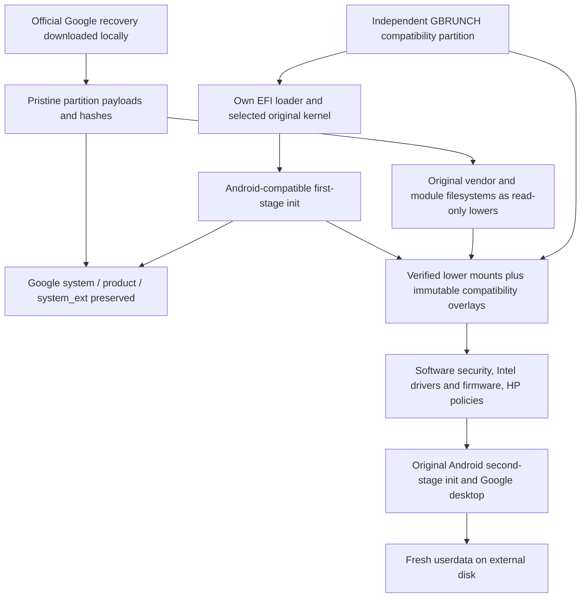

> Historical research/build log. Earlier statements describe that stage of development. See [README.md](README.md) for current status. Referenced private recovery files and raw device logs are intentionally not published.

# GBRUNCH feasibility and recovery-image analysis

Research snapshot: 7 October 2026. Target: generic Intel UEFI PCs, initially HP Envy x360 15-fe1000-series / Core Ultra 7 155U. All experiments in this report ran in the Work environment. No laptop was accessed or installed, and no Google system image was patched or published.

## Assessment

**An experimental x86 Googlebook port is technically plausible, and there is enough evidence to begin it. A usable HP desktop is not yet demonstrated.** Ruby already supplies an x86 Android 17 desktop, a bootable EFI-capable GKI kernel, Intel Mesa Vulkan, minigbm, DRM composer, desktop networking and USB-camera HALs. It also ships several Meteor Lake drivers. This is substantially closer to the target hardware than the ARM Mica image.

The difficult parts are the Android first-stage boot/compatibility-layer handoff, security services spanning three partitions, Meteor Lake firmware and display admission, and HP audio/sensors/power integration. Replacing the kernel with an ordinary distribution kernel or adding Brunch's software TPM does not solve these interfaces.

**Completed proof:** an initial 130 MiB GPT disk file with its own EFI loader boots Ruby's unchanged kernel through OVMF/GRUB in x86 QEMU, runs a custom diagnostic initramfs, loads four original signed virtio modules, enumerates NVMe and virtio block devices, and powers off. This is a kernel/UEFI proof, not a booted Googlebook desktop. Further QEMU tests now reach Google’s original Android second-stage init with all six logical partitions mounted through successful AVB/dm-verity setup and SELinux enforcing. An independent compatibility partition mounts at `/oem`; its init configuration starts Cuttlefish software security processes. This remains an incomplete userspace experiment, with manifest overlay and startup dependencies still blocking a desktop. See section 13.

Recommended first implementation: keep the stock kernel and its matching modules; preserve Google's partition bytes; introduce a separately built Android first-stage compatibility init and immutable compatibility filesystem; selectively replace vendor services and mask incompatible system/service declarations at runtime. Start with fresh external-image userdata and an offline recovery-import update process. Do not promise stock OTA support initially.

## 1. Official recovery discovery

The public catalog actually used by Google's **Device Recovery Utility**, rather than the older ChromeOS recovery list, is:

<https://dl.google.com/dl/edgedl/device/recovery/production_recovery.json>

It was located in the downloaded official extension's `app_compiled.js`. The extension is [Google's Device Recovery Utility](https://chromewebstore.google.com/detail/device-recovery-utility/pocpnlppkickgojjlmhdmidojbmbodfm), ID `pocpnlppkickgojjlmhdmidojbmbodfm`. The legacy `recovery.conf` has no Googlebook records in this snapshot. Both catalogs and the extension remain local.

The production catalog currently has five records, all STABLE, dated 2026-10-05, on `arsp-26Q3-desktop-release`. The complete **current publicly listed x86 set is three images**:

| Model | Board / target | Architecture evidence | Version / build | Official recovery ZIP |
|---|---|---|---|---|
| ASUS Googlebook 14 | lapis / lapis-user | Intel platform; x86_64 expected, binary not downloaded here | CL3B.260622.271.R1 / 16452207 | [Google lapis](https://dl.google.com/device/recovery/lapis-user/16452207/recovery.zip) |
| Acer Googlebook 14 | moonstone / moonstone-user | Intel platform; x86_64 expected, binary not downloaded here | CL3B.260622.271.R1 / 16452207 | [Google moonstone](https://dl.google.com/device/recovery/moonstone-user/16452207/recovery.zip) |
| Lenovo Googlebook 15 | ruby / ruby-user | **Directly verified** x86-64 kernel and ELF userspace | CL3B.260622.271.R1 / 16452207 | [Google ruby](https://dl.google.com/device/recovery/ruby-user/16452207/recovery.zip) |

[Google's model comparison](https://googlebook.google/shop/compare/) identifies the Intel models and the Snapdragon models. The catalog itself has **no architecture field**. Mica (Dell XPS Googlebook) and quartz (HP Googlebook 14) are the two ARM platform entries, build 16471258 / CL3B.260622.273.R1, and are not x86 candidates. All five download URLs returned HTTP 200 to HEAD requests. This establishes the current public production set, not completeness of historical/unlisted/internal builds. No internal catalog or credentials were used.

All three Intel raw images are cataloged as 19,069,493,760 bytes. Catalog `zipfilesize=1` is a placeholder, not the download size. Catalog ZIP MD5s:

| Board | MD5 |
|---|---|
| lapis | `38873eac8ff5b060baf229b7bcf7ec05` |
| moonstone | `e025f213660ddbafe0f1f33c5a2a34bc` |
| ruby | `0567fe2ed0dd1c1753b383a6b3dbfe81` |

Ruby was selected because it is an official Intel desktop recovery with the same contemporary release as the other two; direct inspection reveals a Panther Lake/Fatcat vendor stack with usable Meteor Lake driver coverage. Selection is provisional: the other Intel vendors may offer useful firmware/audio variations, but their contents have not been compared.

Ruby download and verification:

* ZIP: **7,816,442,985 bytes**; MD5 matches Google's catalog.
* ZIP SHA-256: `3c4dc7f636f29a1207e71d001fd2864aa20ce8354faecd2ef1ae47582b977f6c`.
* Single ZIP member: `android-desktop_signed_recovery_image.bin`.
* Raw SHA-256: `4f4490415d4db0721fa99ad10abd64b1b05c284b6c0e413907da948561de8c9e`.
* Raw MD5: `a12663524efd8b2099753cab67d10b1f`.
* Original ZIP and sparse raw file are retained in `downloads/`; raw logical length remains the official length.

HTTPS/catalog provenance and the embedded AVB signature are separate checks. Embedded-key verification alone is not an independently authenticated Google trust anchor.

## 2. Direct Ruby forensic results

Inspection used a read-only Python GPT/liblp/Android boot parser, upstream `avbtool`, Linux `extract-vmlinux`/`extract-ikconfig`, EROFS utilities, ELF section parsing, and local filesystem extraction without mounts. No extracted Android binary was executed on the host. JSON evidence records exact offsets, UUIDs, hashes, boot headers, CPIO inventories and module metadata.

### 2.1 Physical GPT

The table has 30 populated entries; entry 11 is absent. Names alone are misleading: several inherited ChromeOS-named partitions are empty or carry recovery firmware material. Primary and backup GPT header/table CRCs were validated; the tables are identical and the backup header is at the final raw-image sector. Sizes and offsets below are decimal bytes, in GPT index order.

| Index | Partition | Offset | Bytes |
|---:|---|---:|---:|
| 1 | userdata | 14,598,275,072 | 4,336,885,760 |
| 2 | KERN-A | 209,715,200 | 536,870,912 |
| 3 | super | 746,586,112 | 12,884,901,888 |
| 4 | KERN-B | 13,631,488,000 | 4,194,304 |
| 5 | ROOT-B | 13,635,682,304 | 536,870,912 |
| 6 | KERN-C | 136,314,880 | 512 |
| 7 | ROOT-C | 136,315,392 | 512 |
| 8 | OEM | 138,412,032 | 4,194,304 |
| 9 | ota_recovery_a | 2,097,152 | 134,217,728 |
| 10 | ota_recovery_b | 18,935,160,832 | 134,217,728 |
| 12 | EFI-SYSTEM | 142,606,336 | 67,108,864 |
| 13 | boot_a | 14,172,553,216 | 67,108,864 |
| 14 | boot_b | 14,239,662,080 | 67,108,864 |
| 15 | vbmeta_a | 14,306,770,944 | 4,194,304 |
| 16 | vbmeta_b | 14,310,965,248 | 4,194,304 |
| 17 | metadata | 14,315,159,552 | 67,108,864 |
| 18 | init_boot_a | 14,382,268,416 | 8,388,608 |
| 19 | init_boot_b | 14,390,657,024 | 8,388,608 |
| 20 | vendor_boot_a | 14,399,045,632 | 33,554,432 |
| 21 | vendor_boot_b | 14,432,600,064 | 33,554,432 |
| 22 | pvmfw_a | 14,466,154,496 | 4,194,304 |
| 23 | pvmfw_b | 14,470,348,800 | 4,194,304 |
| 24 | misc | 14,474,543,104 | 4,194,304 |
| 25 | RWFW-A | 136,315,904 | 512 |
| 26 | RWFW-B | 136,316,416 | 512 |
| 27 | recovery_a | 14,478,737,408 | 33,554,432 |
| 28 | recovery_b | 14,512,291,840 | 33,554,432 |
| 29 | desktop_security_persist | 14,545,846,272 | 16,777,216 |
| 30 | desktop_security_storage | 14,562,623,488 | 33,554,432 |
| 31 | frp_persist | 14,596,177,920 | 2,097,152 |

`EFI-SYSTEM` is **entirely zero-filled**, with no FAT filesystem or bootloader. `KERN-A` starts zero-filled; `KERN-B` contains SquashFS; `ROOT-B` is EROFS containing `chromeos-firmwareupdate`, rather than the normal Android system filesystem. The `recovery_a/b` partitions start zero-filled. These observations explain why copying Brunch's ChromeOS boot arrangement directly would be wrong. Recovery firmware binaries were not run.

### 2.2 Dynamic partitions and relationships

`super` is a 12 GiB liblp container. Geometry and metadata SHA-256 checks pass; all six metadata copies (three slots and their backups) are present and have the same layout in this recovery. Every nonempty logical partition has one linear extent. Full groups, flags, maximum sizes and extent locations are in `extracted/ruby/super.json`.

| Logical partition | Bytes | Raw absolute offset |
|---|---:|---:|
| system_a | 1,133,674,496 | 747634688 |
| system_b | 4,406,931,456 | 1882193920 |
| vendor_a | 387,108,864 | 6289358848 |
| vendor_b | 0 | — |
| product_a | 1,971,519,488 | 6677331968 |
| product_b | 0 | — |
| system_ext_a | 252,346,368 | 8649703424 |
| system_ext_b | 0 | — |
| system_dlkm_a | 9,232,384 | 8902410240 |
| system_dlkm_b | 0 | — |
| vendor_dlkm_a | 18,096,128 | 8911847424 |
| vendor_dlkm_b | 0 | — |

The normal OS is slot A. `system_a` contains the Android root layout, `/system`, bootstrap libraries, init, APEXes and framework. `system_ext_a` contains desktop additions, Trusty VM launchers/images and associated framework-side security declarations. `product_a` contains Google/OEM apps, preloads/configuration, overlays, fonts, permissions and product APEX content. `vendor_a` contains native hardware HALs, firmware, init, VINTF, policy and vendor APEXes. All six active logical filesystems are EROFS with AVB hashtrees/FEC outside the filesystem data region.

`system_b` is **system-other**, not a complete alternate OS: its root has `preloads`, `product`, `system`, `system_ext` and `system-other-odex-marker`. Vendor property `ro.cp_system_other_odex=1` confirms the precompiled-artifact role. Other B logical partitions are empty. Do not overwrite A with system-other.

There is no separate `odm` or `odm_dlkm` partition. Root `/odm/{etc,lib64,firmware,...}` entries link to `/vendor/odm/...`; the actual vendor ODM subtree is small. `system_dlkm` carries signed GKI modules; `vendor_dlkm` carries the board/external driver set. `/system/lib/modules` links to `/system_dlkm/lib/modules`, and `/vendor/lib/modules` links to `/vendor_dlkm/lib/modules`. The normal vendor ramdisk also carries early-load modules.

The actual first-stage fstab lists all six logical filesystems with `logical,first_stage_mount,slotselect,avb=vbmeta`, preferring EROFS and providing ext4 alternatives. `/data` is ext4 with `fileencryption=aes-256-xts:aes-256-cts`, quota, fsverity, block checkpoints, formattable/late-mount behavior and a vold key directory under `/metadata/vold/metadata_encryption`. `/metadata` is ext4 and first-stage mounted. The key-directory name is not itself an explicit metadata-encryption mount option. NVMe/MMC/USB wildcard entries also expose additional disks to vold; a compatibility fstab must scope the experimental OS disk and exclude internal storage from automatic formatting/recovery behavior.

The vendor enables Virtual A/B, userspace snapshots, compression, XOR/batch writes, io_uring and ublk. The listed A/B partitions are `boot,init_boot,product,pvmfw,system,system_dlkm,system_ext,vbmeta,vendor,vendor_boot,vendor_dlkm`. Runtime slot/update behavior must be established with boot-control and snapshot metadata, not inferred from the recovery's populated extents.

System fingerprint is `Android/desktop_system/desktop:17/CL3B.260622.271.R1/16452207:user/release-keys`; vendor fingerprint is `Lenovo/ruby/ruby:17/CL3B.260622.271.R1/16452207:user/release-keys`. SDK is 37, full SDK 37.1; security patch is 2026-09-01. Native ABI is x86_64 with advertised arm64-v8a compatibility. Vendor ART ISA variant is `pantherlake`; the HP CPU is Meteor Lake. This needs an explicit compatibility property policy and validation of precompiled artifacts. A generic supported ART variant plus regeneration in userdata is preferable to assuming Panther Lake-tuned artifacts execute unchanged. Native bridge support and third-party ARM apps are a separate test from boot feasibility.

### 2.3 Boot images, including the recovery slot

| Component | Slot A normal image | Slot B recovery-media image |
|---|---|---|
| boot | Android boot header v4, 1,584-byte header; 26,723,328-byte kernel, no ramdisk, no embedded boot signature | Same kernel SHA-256 and v4 structure |
| init_boot | v4, 2,731,866-byte generic ramdisk; kernel size 0 | v4, 2,731,868-byte generic ramdisk; kernel size 0 |
| vendor_boot | v4, 2,048-byte pages, 2,128-byte header; ramdisk 31,793,538 bytes; no DTB | v4, ramdisk 28,148,531 bytes; no DTB |
| vendor fragments | platform/type1: 2,989,236; recovery/type2: 24,600,967; dlkm/type3: 4,203,335 bytes | One platform/type1 fragment; recovery-media boot configuration |
| bootconfig | 122 bytes: hardware/platform android-desktop; parallel module loading | 209 bytes; additionally `androidboot.force_normal_boot=0` and `androidboot.init_rc=/vendor/etc/init/recovery_media.rc` |

Both boot/init_boot command-line fields are empty. Hardware command line is in vendor_boot. Fragment board IDs are all zero. Normal boot must select the normal platform and dlkm fragments plus generic init_boot ramdisk, respecting Android assembly/override order; including the recovery fragment indiscriminately is incorrect. All fragment CPIO ownership, modes, symlinks and hashes are inventoried, although the simple extraction tool intentionally extracts only regular ramdisk files.

`pvmfw_a` is an Android boot v3 wrapper with a 968,160-byte kernel payload and no ramdisk. It is security/pVM firmware material, not the host Linux kernel. Keeping the partition bytes does not make protected VM services operational on generic hardware.

### 2.4 Kernel and command line

Kernel: **`6.18.21-android17-5-g3938c8d97142-ab16302624`**, x86-64, PREEMPT, Kleaf build, dated 9 September 2026. It is an LZ4-compressed x86 bzImage with EFI64 stub/handover and Linux boot protocol 2.15. Kernel payload SHA-256 is `7816c5d5b3500093e597b7362ecab103d5a32141b100d3eb7a8b33221fce7f41`.

The Android17-6.18/KMI generation5 naming, GKI hidden configuration options, signed GKI module set, MODVERSIONS/protected-module policy and separated vendor module tree establish the GKI organization. This is not an ordinary PC distribution kernel with every driver enabled.

Relevant extracted config:

| Facility | Actual configuration / implication |
|---|---|
| Boot/storage | EFI and EFI_STUB/handover enabled; NVMe and xHCI/USB storage/UAS built in |
| Filesystems | EROFS, ext4, OverlayFS, device mapper/verity/FEC, filesystem encryption enabled |
| Userspace devices | **DEVTMPFS disabled**; Android ueventd normally creates nodes |
| Display console | VT and simpledrm disabled; normal Linux console assumptions fail |
| Intel GPU | i915 and Xe not built into GKI; shipped external Xe module supplies graphics |
| Input | evdev, multitouch and I2C-HID support; ACPI I2C-HID glue is external |
| Camera | UVC built in; board-specific camera modules/services also shipped |
| Sensors | ISH support supplied by vendor modules, not built-in GKI |
| Binder | C implementation built in; Rust Binder module shipped; vendor cmdline selects Rust |
| Hypervisor | KVM Intel/AMD and pKVM x86 support present |
| Security | SELinux enabled; CFI enabled and nonpermissive; module protection described below |

The **complete original vendor command line** is retained in `vendor_boot_a/header.json`. Notable entries include `kvm-intel.pkvm=1`, `intel_iommu=igfx_off`, `binder.impl=rust`, `firmware_class.path=/vendor/firmware`, `fred=on`, forced SOF/IPC/SoundWire parameters, Xe PSR controls, performance governor, console suppression and panic/watchdog settings. Most importantly it contains **`spi-intel.writeable=1 spi-intel.ignore_protection_status=1`**. GBRUNCH must not forward that board command line wholesale. Use an allowlist, do not load SPI flash/update components, and do not apply Ruby CPU power limits to the HP. The current diagnostic probe passes only init/serial/logging parameters and never invokes Android or firmware services.

### 2.5 AVB and actual verification

Slot A vbmeta is `SHA256_RSA4096`, embedded key SHA-1 `9a7e2fba77d349864cdd66f7639cf59c8663a403`, rollback index 1339/location0, flags0, release string `avbtool 1.4.0`. It is a flat descriptor set, not a chain to subordinate vbmeta partitions.

Hash descriptors cover **boot, init_boot, pvmfw, vendor_boot**. Hashtree descriptors cover **system, system_ext, product, vendor, system_dlkm, vendor_dlkm**, using SHA-256, 4 KiB blocks and two FEC roots. The verifier regenerated all six trees directly from the raw logical extents and compared both root digests and stored trees. All pass. All four boot hashes and the embedded RSA signature also pass. FEC parity itself was not recalculated.

Slot B is different: `SHA512_RSA4096`, key SHA-1 `ce679fefa639dcf8e94e8b28ad6c6f4a07cf2ac3`, flags0, same rollback index, `user/dev-keys` boot fingerprints. It has only four hash descriptors, for **boot_b, init_boot_b, pvmfw_b, vendor_boot_b**; no system trees. Its embedded signature and all four hashes were separately verified successfully. B's recovery-media configuration is direct evidence that it is not a conventional ready-to-boot alternate system slot.

No active slot-A descriptor covers `system_b`, userdata, metadata, desktop security storage/persist or FRP. Absence from vbmeta is not a statement that their runtime content lacks all other security mechanisms.

Preserving verity on immutable system lower filesystems is realistic. An external kernel/initramfs or vendor overlay changes the overall boot trust chain and runtime vendor view; it cannot be called original Google Verified Boot. Stock vendor verity can authenticate the **lower** vendor bytes while a locally trusted compatibility layer overlays them. The overlay contents require their own integrity policy. Avoid global `vbmeta flags=3` shortcuts.

### 2.6 Module ABI and signing

There are **643 module-file records**, including ramdisk copies: 100 in system_dlkm, 484 in vendor_dlkm, and 59 in the normal vendor ramdisk. 111 file records have appended signatures. System_dlkm modules are signed; the external vendor set is unsigned. Inventory includes ELF machine, `.modinfo`, aliases, dependencies, firmware names and basic/extended MODVERSIONS CRCs.

GKI module vermagic matches host kernel commit/build; external modules report `6.18.21-android17-5-ga3bbc4527b7b-ab16320342`. That build-suffix difference alone does not disqualify a module on a stable KMI kernel. The actual comparison finds **4,501 kernel exports, 32,713 matching module imports supplied by that kernel, zero CRC mismatches**. For example Xe has 921 matching core imports; 247 imports are not exported by the core and require other modules. Not-in-core is not automatically an unresolved-symbol error. This check does not independently prove every intermodule dependency, namespace admission, CFI compatibility or load success.

Config has `MODVERSIONS`, BASIC and EXTENDED MODVERSIONS, `MODULE_SIG`, `MODULE_SIG_ALL`, RSA/SHA1 module signing and `MODULE_SIG_PROTECT` with a protected module name list. `MODULE_SIG_FORCE` is unset. **That does not mean arbitrary unsigned replacements are accepted:** protected exports/modules, CRCs and CFI still matter. The QEMU probe successfully loads original signed `virtio_pci_modern_dev`, `virtio_pci_legacy_dev`, `virtio_pci` and `virtio_blk`; it does not yet load Xe/SOF on real hardware.

Keep original kernel/module pairs first. For missing hp-wmi or VM-specific drivers, build against the exact Android17-6.18 KMI/config/toolchain and exported ABI, or build a controlled kernel plus the entire required module set. A random Brunch/Ubuntu kernel paired with these modules is not an acceptable starting assumption. See [AOSP stable KMI](https://source.android.com/docs/core/architecture/kernel/stable-kmi) and [kernel modules](https://source.android.com/docs/core/architecture/kernel/modules).

### 2.7 Vendor HALs and hardware-specific services

The inventories distinguish compatibility-matrix requirements from provided manifest HALs; the original combined 553-record XML inventory is not a count of running services. The manifest-filtered inventory has 79 records across the extracted normal partitions (APEX manifests require separate inclusion). The init-service inventory has 184 declarations across system, system_ext and vendor, not 184 services guaranteed to start.

Important vendor groups:

| Area | Shipped implementation | GBRUNCH action |
|---|---|---|
| Graphics | AIDL allocator3/minigbm, native mapper5/minigbm, composer3 AIDL5/DRM | Retain initially; validate Xe/MTL import/export/modifiers/synchronization |
| Network | Desktop Wi-Fi HAL plus extension, wpa_supplicant/hostapd, desktop Bluetooth HCI | Retain generic Linux-facing implementations; supply exact firmware/module loads |
| Input | Linux evdev; desktop keyboard-proxy and touchpad-inhibitor services | Validate HP events and SW_TABLET_MODE; avoid assuming Chrome EC is present |
| Camera | AIDL USB provider and legacy camera/libcamera pipeline | Start with USB UVC; disable unsupported board camera stack |
| Audio | Desktop DRAS vendor APEX, AIDL core/effects, Bluetooth/r_submix modules | Preserve ALSA-facing HAL, add HP card/mixer/firmware/calibration configuration |
| Sensors | AIDL multihal + Desktop-IIO HIDL2.1 sub-HAL | Map HP IIO/HID/ISH channels and orientations; establish hinge/tablet signals |
| Power/thermal | Pixel/perfmgr/thermal-style services plus Intel and desktop extensions | Replace board policies/paths; retain generic components only after inspection |
| Boot/update | Android desktop boot HAL; fwupd, fwtool, futility/vboot, VPD and EC executors | Replace boot-control with file-image slot implementation; suppress device firmware writes |
| Security | Trusty Gatekeeper/Secretkeeper/Weaver; desktop StrongBox APEX | Substitute compatible software services and reconcile declarations |
| Other | OEM lock, lights/health, NPU, disk info, snapshot collector, face/CrosFP | Treat board-specific functionality as optional; do not advertise dead HAL instances |

`init.fatcat.rc` and `init.ruby.rc` contain board power limits and Xe/driver tuning. Merely loading all modules and leaving those scripts intact is not a generic-PC compatibility layer.

### 2.8 KeyMint, Gatekeeper, Trusty, GSC and TPM

Ruby's security architecture differs materially from the simple “hardware TEE absent, graft vendor” picture:

* System property `trusty.security_vm.enabled=1` and vendor properties advertise hypervisor/protected VM support.
* **system_ext** supplies `trusty_security_vm_launcher`, signed Trusty images and protected/nonprotected VM init services. Protected paths use VSOCK CID200 and boot-source-specific internal/external images, including `--protected --disable-secretkeeper`.
* **system_ext's framework VINTF manifest** declares default KeyMint5, remotely provisioned component3, secure clock and VM-side shared-secret/provisioning/finger-guard accessors. Stock KeyMint service startup depends on `trusty.security_vm.keymint.enabled=1`.
* **vendor** supplies Gatekeeper Trusty, Secretkeeper Trusty, Weaver, storage/security integration and the StrongBox desktop APEX. Gatekeeper uses `/dev/trusty-ipc-dev0` unless a VSOCK property redirects it. Weaver startup is tied to protected VM support.
* **system** has GSC daemon/startup logic. `gscutil.rc` runs on post-fs, waits for `/dev/tpm0`, then calls `gscutil --direct-gsc perform-os-startup` with Google GSC firmware ZIPs. This is a firmware/security dependency outside vendor, and must be suppressed by compatibility-init/runtime masking before it runs.

The “nonsecure Trusty” fallback is not automatically a working generic security solution: the inspected branches launch a VM without setting the same KeyMint-enabled property as the protected paths. Setting protected VM support to zero alone is insufficient. The HP's generic TPM2/fTPM is not a Google Titan/Cr50 GSC implementation. Brunch's swtpm supplies TPM commands, not Google's GSC/PinWeaver/Trusty/attestation semantics.

The corresponding official x86 Cuttlefish donor **exists and was downloaded**: Android CI build `16373615`, target `aosp_cf_x86_64_only_phone-userdebug`, artifact `aosp_cf_x86_64_only_phone-img-16373615.zip`. It is 1,163,638,742 bytes, SHA-256 `601d55e3197a2a612becc6931f111fd00caac5cbc70e0fa8261fbdb4cb22c695`; MD5 matches its official storage ETag. [Official artifact page](https://ci.android.com/builds/submitted/16373615/aosp_cf_x86_64_only_phone-userdebug/latest/aosp_cf_x86_64_only_phone-img-16373615.zip).

Direct donor inspection confirms `com.android.hardware.keymint.rust_nonsecure.apex` and `com.android.hardware.gatekeeper.nonsecure.apex`, alongside **different** `cf_remote` and guest-Trusty variants. Select the standalone nonsecure services; remote variants expect Cuttlefish host infrastructure. The nonsecure KeyMint binary is ELF x86-64 and links binder_ndk/log/libc/libcrypto. Its private libcrypto is staged separately to avoid globally replacing Google's crypto library. The donor advertises KeyMint5, RKP3, secure clock and shared secret. Gatekeeper APEX also advertises `ISharedSecret/gatekeeper`; credential/HAT sharing must be tested together.

A vendor-only transplant is therefore **not yet proven sufficient for Ruby**. The initial design must reconcile the system_ext framework manifest and stock init actions, not merely add a duplicate device KeyMint declaration. Prefer explicitly masking those small service/manifest views from the independent compatibility layer while retaining all original on-disk bytes. Do not claim security-equivalent attestation, StrongBox or protected key storage. Software-key device encryption may be useful against casual offline inspection but does not reproduce the original hardware trust boundary. DRM/Play Integrity/enterprise enrollment may reject the environment; successful UI boot is independent of those services.

Public Trusty desktop sources were also inspected at a pinned commit. They illustrate x86 Trusty/pinweaver/keymint/gatekeeper composition, but their 2025 public code is not asserted to be the exact 2026 shipping implementation.

### 2.9 GPU/display

Vendor properties select **Intel Vulkan, ANGLE EGL, minigbm gralloc**, with HWUI/RenderEngine Vulkan enabled and wide-color/HDR features. `vulkan.intel.so` identifies **Mesa 26.1.3 (git-a386f8e15a)** / Intel ANV and contains Meteor Lake paths. Composer and allocator are already generic DRM/minigbm components, unlike Mica's Qualcomm stack.

Shipped Xe aliases include MTL `8086:7d40/7d41/7d45/7d51/7d55`. The matching HP owner log reports `7d45`, which is in this alias set. Nevertheless an alias is not a tested probe: inspect force-probe policy, required display helper modules, firmware requests, GuC/HuC/GSC/DMC files, render-node permissions, KMS connectors and Android format/modifier/fence interoperability. No i915 module is shipped. The HP works with i915 on a normal Linux kernel in the published log; switching it to Ruby's Xe path is a real remaining validation task.

Stock recovery firmware supplies Panther Lake Xe blobs, not a complete Meteor Lake set. Add matching official linux-firmware files through the compatibility layer. Keep stock Mesa/ANGLE/minigbm/composer first; use a software renderer only as a diagnostic fallback. Mica's Venus/VirGL/Metal bridge and macOS host graphics patches have no role in bare-metal Intel scanout.

### 2.10 Input, wireless, audio, camera and sensors

**Input:** Android's InputReader consumes Linux evdev. I2C-HID ACPI, Intel LPSS/pinctrl, HID multitouch and USB HID drivers are the relevant physical stack. There is no need for Mica's custom virtual tablet Java/input channel on bare metal. Touchscreen/touchpad event classification, HID descriptors, pen handling, keyboard rotation suppression and ueventd permissions still need testing.

**Wi-Fi:** vendor contains iwlwifi, iwlmvm, iwlmld and an iwl7000 mac80211 stack. Ruby's init favors newer-board iwlmld; an AX211 configuration likely needs the appropriate iwlmvm path. Alias `8086:7e40` is present. Stock firmware includes primarily `iwlwifi-sc-a0-wh-*`, not the AX211 firmware set. Pin firmware to the shipped driver's API requests and actual CNVi/subsystem identity. Desktop Wi-Fi/supplicant/hostapd use Linux networking rather than assuming a virtual NIC.

**Bluetooth:** btusb/btintel modules and a desktop HCI HAL are present; Google's Bluetooth framework/APEX remains in system. Intel USB transport firmware and coexistence/power behavior need testing. Do not transplant Cuttlefish's virtual Bluetooth service for a physical AX211 transport.

**Audio:** direct extraction of the desktop audio APEX reveals Rust `dras.core.audio`, C++ Bluetooth/r_submix service, extension effects and `dras.sound-card-init.audio apply_calibration_values --retry 100`. ELF strings show ALSA card management, TinyALSA and mixer-path handling. Stock card configuration is selected for a different codec/amp board; USB devices have many generic card profiles. This is a native ALSA-facing stack, not simply CRAS/PipeWire from ChromeOS. HP SOF IPC4, NHLT, HDA codec, amplifier firmware/properties, mixer routing and DRAS XML/calibration must all agree. Cuttlefish's virtual audio APEX is useful for a VM, not an automatic physical-SOF replacement.

**Camera:** UVC is built in and a USB AIDL provider is shipped. The published HP configuration has a USB webcam, making UVC the preferred first route. If the actual laptop has an MIPI/IPU sensor, investigate the appropriate IPU generation, sensor firmware, Intel userspace pipeline and Android adapter separately; Ruby's newer board camera stack cannot be assumed compatible. The owner's driver binding alone does not prove a functioning camera app.

**Sensors:** `/vendor/etc/sensors/hals.conf` selects `android.hardware.sensors@2.1-Desktop-IIO-Subhal.so`. Intel ISH IPC/ISHTP/HID-sensor drivers are shipped, but recovery firmware is board-specific. Linux IIO channels and HID sensors are plausible donor interfaces. A 360-degree hinge may require HP ACPI/WMI or dual-sensor fusion, and Android orientation/tablet policy requires more than the existence of an accelerometer. The exact HP hinge and ISH device IDs remain unestablished.

## 3. What gbos-vm actually implements

Source pinned to `cb3f732d07d1ed5d3dcc30a3adba28b7e41cd67d`; the actual scripts and patches were inspected locally. Start at [build-image.sh](https://github.com/skylartaylor/gbos-vm/blob/cb3f732d07d1ed5d3dcc30a3adba28b7e41cd67d/build-image.sh), [make_mica_security_port.py](https://github.com/skylartaylor/gbos-vm/blob/cb3f732d07d1ed5d3dcc30a3adba28b7e41cd67d/image/make_mica_security_port.py), [make_mica_gpu_initrd.py](https://github.com/skylartaylor/gbos-vm/blob/cb3f732d07d1ed5d3dcc30a3adba28b7e41cd67d/image/make_mica_gpu_initrd.py), [relocate_vendor.py](https://github.com/skylartaylor/gbos-vm/blob/cb3f732d07d1ed5d3dcc30a3adba28b7e41cd67d/image/relocate_vendor.py) and [run_vm.py](https://github.com/skylartaylor/gbos-vm/blob/cb3f732d07d1ed5d3dcc30a3adba28b7e41cd67d/run/run_vm.py).

The pipeline downloads the official Mica recovery and pinned ARM Cuttlefish images locally, verifies hashes, extracts the normal boot kernel/ramdisks, builds replacement vendor content with original metadata, grafts the vendor extent into a cloned disk, optionally relocates a larger vendor extent within super, expands userdata, and boots the original ARM kernel directly under QEMU/HVF. It preserves Google's system/product/system_ext bytes, but **does modify the local vendor partition and boot environment**. It is not already a ROOTC-style separate compatibility partition design.

| Implementation detail | Reusable concept | What must change for Ruby/HP |
|---|---|---|
| GPT/liblp extraction and metadata hashing | Yes | Discover all offsets/extents dynamically; never reuse Mica constants |
| Software KeyMint extraction, private crypto library, VINTF additions | Yes | Use x86 donor; reconcile Ruby's framework-side KeyMint declarations |
| Nonsecure Gatekeeper APEX, removing Weaver declaration | Yes | Validate shared-secret/HAT/Secretkeeper requirements and policy |
| StrongBox vendor APEX deselection | Yes | Audit Ruby selection and startup triggers |
| Disable Qualcomm ADSP/CDSP services | Hardware-specific | Ruby has no equivalent Qualcomm target stack; disable Intel/Ruby-specific unsafe actions instead |
| Replace Qualcomm composer/allocator with minigbm/DRM | Architectural idea | Ruby already has minigbm/DRM; preserve it initially |
| Mesa Venus/VirGL, ANGLE toggles, Metal buffer workarounds | VM/Apple-specific | Native Intel ANV/Xe path on bare metal |
| CF audio APEX and XML; remove dead SoundTrigger instance | Optional-HAL technique | Physical HP SOF/DRAS routing requires independent integration |
| Boot HAL replaced with AOSP default under original service identity | Yes | Implement Android slot/misc semantics without firmware writes |
| Enforcing SELinux binary policy patch for memfd access | Narrow-policy technique | Recalculate against Ruby policy; never transplant Mica compiled policy |
| Ramdisk concatenation and injected virtio/GPU/system-heap modules | Yes | Correct x86 fragment selection and exact KMI; no ARM modules |
| EROFS incremental import preserving uid/gid/mode/xattrs/labels | Yes | Tool/version pin and label-aware output; preferably a separate compatibility image |
| Hard-coded root xattr NID54/checksum repair | Mica-layout-specific | Replace with robust metadata-aware tooling; no hard-coded inode offsets |
| APFS `cp -c` vendor graft/backups | Host-specific | Linux reflinks/sparse local files; immutable official base |
| ARM `virt`, GIC3, ttyAMA0, Apple IPA/HVF | ARM/QEMU-specific | q35/OVMF for VM; ACPI/UEFI for PC; no ARM DTB |
| Offline provisioning/runtime diagnostics | Generally reusable | Fresh userdata, avoid relying on bypassed Google enrollment/security semantics |
| SPICE/Cocoa viewer/custom virtual tablet input | Host/VM-specific | Physical evdev/KMS; separate minimal VM diagnostics |

The Mica initramfs strategy changes the boot path externally; its vendor fstab override removes AVB only for vendor, not all system partitions. Larger vendor images are relocated into free super space and every LP metadata checksum is updated. Original vendor files and labels are carefully retained using incremental EROFS import, unlike a naive unpack/repack.

The project reports successful real Google desktop operation on its tested Apple Silicon setup. That report was not independently reproduced here. Its own remaining GSC/TPM crash-loop observations reinforce the need to audit services outside the grafted vendor. The ARM-only kernel extraction assertions, hard-coded extents and Apple host patches make it an excellent reference implementation, not an x86 build script that can be retargeted by changing one URL.

## 4. Brunch implementation, not just its README

Source inspected at branch r152 commit `3efdeea8332675c946d0a9591cd52fbda9daaf99`. Its current preparation script labels ChromeOS R154 and prepares 6.6/6.12/6.18 kernels; branch name alone is not the configuration. Relevant files are `scripts/chromeos-install.sh`, `scripts/brunch-init`, `prepare_kernels.sh`, `build_kernels.sh`, `build_brunch.sh`, `efi-partition/efi/boot/grub.cfg` and `brunch-patches/{20-startup,40-swtpm,49-disable_fw_updates,50-add_generic_firmwares,99-updater}.sh`.

**Partition/boot:** the installer builds a ChromeOS GPT layout with a substantial ROOTC compatibility partition (partition7). ROOTC holds the selected custom kernel, initramfs, drivers, tools, firmware and patch scripts. EFI contains shim/GRUB and certificate/legacy-boot support. GRUB loads the ROOTC kernel and initramfs plus CPU microcode. This bypasses reliance on an OEM ChromeOS verified boot firmware path.

**Recovery preservation and patching:** the recovery input remains unchanged, and an operational pristine recovery root is kept in ROOT-B. The installer puts recovery KERN-B in KERN-A and keeps the recovery root as the source for a patched ROOT-A. `brunch-init` detects the framework/kernel/options/patch state, copies ROOT-B to ROOT-A when needed, changes ChromeOS filesystem protection metadata, resizes/mounts it, replaces `/lib/modules`, executes the patch scripts, and switches into the patched root. Brunch therefore **does patch ChromeOS's running system root**; ROOTC is the source of compatibility tools, not a general immutable-system overlay implementation.

**Kernel/firmware:** Brunch builds generic ChromiumOS/mainline kernels with its patches and extra drivers, and packages firmware, SOF assets, ALSA UCM and microcode. Kernel/module replacement is possible in ChromeOS's architecture, but Googlebook's Android GKI/module ABI must be independently respected. `50-add_generic_firmwares.sh` also makes audio/camera/power adjustments; copying firmware alone is not a universal board port.

**Startup/security:** `20-startup.sh` replaces ChromeOS startup/mount logic, including stateful paths and bindings. `40-swtpm.sh` creates an Upstart TPM2 simulator service using `swtpm chardev --vtpm-proxy --tpm2`, persistent state under STATE/brunch/swtpm, and a `/dev/tpm0` wait. This is a software TPM environment, not hardware-backed assurance. `49-disable_fw_updates.sh` stubs firmware tools and removes board updater services. Its design strongly supports an explicit “never update the PC firmware” rule for GBRUNCH.

**Updates:** init detects KERN-B priority becoming at least KERN-A's priority, uses the updated pristine ROOT-B, rebuilds ROOT-A with compatibility changes and normalizes priorities. Framework/options changes also trigger rebuilding. The manual updater can replace ROOTC/EFI or import another recovery into ROOT-B before repatching. This is a concrete update adaptation mechanism, not a promise that all future ChromeOS changes work. Googlebook's dynamic Virtual A/B snapshots, init_boot/vendor_boot, boot HAL and APEX updates need a different implementation. ROOT-B in Ruby is not Brunch's pristine OS root.

The useful Brunch ideas are independent compatibility storage, generic UEFI boot, hardware-driver/firmware packaging, firmware-update suppression, explicit update detection/rebuild and rollback. Its root-copy patching, Upstart services and ChromeOS TPM/startup assumptions should not be copied into Googlebook.

## 5. AluminiumOS relevance

Source pinned to `a2b497095f282852d4d30f70ec214abc869e040d` on DEV. `boot_no_trusty.sh` uses **qemu-system-aarch64** / ARM virt with TCG, Cuttlefish boot materials, Pixel/Comet image inputs, virtual graphics and permissive SELinux. An x86 host running this script does not establish a native x86 Googlebook guest.

`make_system.sh` repacks a GSI/system filesystem and changes security/startup behavior, including vold/apexd-related paths and permissive/debug properties. `make_vendor.sh` repacks Cuttlefish vendor. Trusty/DTB/keymint experiments are relevant research references, but its system-image modification strategy conflicts with this task's preservation constraint. No AluminiumOS install or modification script was run.

## 6. HP / Meteor Lake hardware feasibility

[HP's official series specifications](https://support.hp.com/it-it/document/ish_10090929-10113922-16) list 155U/125U, multiple NVMe/display/memory configurations and configuration-dependent wireless options. Two Thunderbolt4 USB-C ports and HDMI are platform options listed for the series. Marketing specifications do not identify the installed HID devices, audio subsystem/amplifiers, sensor firmware or webcam VID/PID.

A [published primary owner log](https://forums.linuxmint.com/viewtopic.php?hilit=155U&p=2550763), dated November 2024, reports a **15-fe1xxx / 155U / board8C4F** configuration on Linux 6.8. Its indexed log was retrievable, although direct page opening returned HTTP403. It demonstrates working i915 rendering, an up Wi-Fi interface, bound Bluetooth/UVC drivers, and failed internal speakers with CS35L41 probe errors. These are configuration-specific observations, **not IDs confirmed for the user's laptop**. A concise evidence record is retained in `evidence/hp-owner-observation.json`.

| Component | Established for that published configuration | Linux / Ruby support and remaining work |
|---|---|---|
| CPU | Core Ultra7 155U, family6/model170/stepping4 | Native x86-64 kernel plausible; no Panther Lake-only userspace ISA assumption |
| Graphics | `8086:7d45`, working i915/Mesa MTL/eDP | Ruby Xe alias exists, Mesa contains MTL; firmware, force-probe, KMS and Android interop untested |
| Audio | `8086:7e28`, SOF MTL; ALC245 and CS35L41/I2C CSC3551 in logs | Matching MTL module exists; exact subsystem ID and amplifier firmware/quirks needed; stock Ruby card config differs |
| Wi-Fi | `8086:7e40`, iwlwifi interface up | Ruby alias exists; AX211-class transport/firmware path to verify; init must select appropriate stack |
| Bluetooth | `8087:0033`, btusb interface up | btusb/btintel and desktop HAL present; firmware/power/coexistence test |
| Webcam | USB `30c9:00ab`, UVC binding | Built-in UVC + Ruby USB HAL promising; actual configuration and application capture test needed |
| Touch HID | `04f3:417a`, ELAN2513:00 | I2C-HID/multitouch plausible; this log does not identify the touchpad or prove all pen/touch functions |
| NVMe | WD SN560 in that configuration | Built-in NVMe; external USB/UAS NVMe preferable first because USB4 PCIe tunneling has extra requirements |
| ISH/hinge/tablet | Exact IDs not established | Ruby ISH modules/IIO HAL exist; actual sensors, firmware, orientations and SW_TABLET_MODE bridge needed |
| HP platform keys | No exact WMI/ACPI table capture | No shipped hp-wmi module found; may need a KMI-compatible module or userspace adapter |
| Suspend/resume | No reliable matching-device test established | ACPI/s2idle, IRQ wakeups, display/SOF/wireless state and Android suspend policy require tests |
| USB4/Thunderbolt | Series capability, controller ID unconfirmed | Thunderbolt module shipped; load early for tunneled boot media; authorization/IOMMU and resume matter |

The speaker log specifically reports missing `cirrus,dev-index` / unsupported platform errors on Linux 6.8; it does not establish that the problem persists in 6.18 or that a known subsystem quirk matches this particular laptop. Speaker support needs exact PCI subsystem and ACPI IDs plus amplifier firmware, not an assumption that a later kernel fixes it.

Linux and ChromiumOS already support Meteor Lake platforms. ChromiumOS's Rex platform is useful evidence of Intel-platform support, **not evidence that Googlebook's Panther Lake vendor policies or Chrome EC services fit an HP**. Keep the HP's UEFI and ACPI; no coreboot/firmware flashing is part of this design. Relevant primary references:

* [Linux iwlwifi support](https://wireless.docs.kernel.org/en/latest/en/users/drivers/iwlwifi.html): AX211 supported since Linux5.14; firmware compatibility still matters.
* [Intel ISH driver architecture](https://www.kernel.org/doc/html/latest/hid/intel-ish-hid.html): IPC/ISHTP clients and HID/IIO integration.
* [Linux Thunderbolt/USB4 documentation](https://www.kernel.org/doc/html/latest/admin-guide/thunderbolt.html): PCIe authorization, IOMMU and tunneling.
* [SOF firmware releases](https://github.com/thesofproject/sof-bin/releases) and [Linux Intel SOF Kconfig](https://github.com/torvalds/linux/blob/master/sound/soc/sof/intel/Kconfig): select matching MTL IPC4 firmware/topologies.
* [ChromiumOS Rex platform](https://chromium.googlesource.com/chromiumos/project/+/refs/heads/release-R141-16404.B/rex/).

Before a physical-image milestone, collect `lspci -nnk` including subsystem IDs, `lsusb`, DMI product/SKU/board, ACPI HID inventory, `/proc/asound` codec/card details, IIO/input properties and a recent working Linux boot log. Collection is a future read-only task; it was not performed on the HP here.

## 7. Proposed GBRUNCH architecture

### Disk and integrity model

Keep official downloads immutable and use a **new regular disk file** as the build output. Preserve required official partition payloads, names and filesystem bytes. Add independent GBRUNCH EFI/compatibility storage without reusing occupied GPT entry numbers or changing liblp extents blindly. A larger output file can reserve additional partition-table space or append aligned partitions before a relocated backup GPT. Validate the complete layout and all retained payload hashes after construction. The raw recovery need not be installed or run as a recovery environment.

For initial experiments, read-only base-image views and a distinct scratch userdata image under QEMU avoid unintended recovery/install behavior. For a later external disk file, use boot-medium UUID identification and scope metadata, misc, FRP and userdata writes to that file's disk only. Generic `/dev/nvme0n1` assumptions and broad recovery-media auto-install paths are forbidden. USB/UAS external SSD boot is the simpler first hardware path; native Thunderbolt-tunneled NVMe requires early controller support and authorization.

Compatibility partition contents: version manifest, pinned kernel choice and unchanged module payloads, generated initramfs, firmware, vendor service/manifest substitutions, ownership/SELinux metadata, compiled policy inputs/output, boot-control helper, rollback configuration and diagnostics. The compatibility partition must have its own integrity checking; writable persistent state belongs elsewhere.

### Init and overlay model

OverlayFS support in the kernel is only a prerequisite. Android first-stage init mounts logical partitions and AVB devices before second-stage init imports vendor/system rc and VINTF. A shell that starts an overlay after normal init is too late. Android's stock debuggable remount/overlay paths are not a guaranteed facility in this release-keys user build.

The proposed implementation is a **small, source-built Android17-compatible first-stage init**, retaining liblp/fs_mgr/libavb behavior and explicit boot-device scoping. It assembles the normal ramdisk, mounts the untouched verified system lower filesystems, mounts/validates compatibility content, builds the permitted vendor view and narrowly masks incompatible system/system_ext init and manifest files, then performs the proper SELinux setup and second-stage handoff to Google's original `/system/bin/init`. A generic BusyBox `switch_root` is not an equivalent replacement. SELinux labeling, mount namespaces, APEX discovery/linker configuration, init import order and framework/device VINTF merging are acceptance gates.

A lower vendor can remain dm-verity-protected while the overlay view incorporates compatibility files; the latter is locally trusted. A read-only reconstructed vendor view stored separately is an alternative if OverlayFS cannot preserve required labels/whiteouts/mount semantics. Neither alternative requires modifying the original Google image. Fine-grained system_ext/system masking is likely necessary for Ruby security; this preserves on-disk images but deliberately changes those files' runtime view. If the framework accepts a vendor-only override without duplicate KeyMint declarations, prefer that smaller scope after demonstrating it.

Keep SELinux enforcing for the actual desktop prototype. Apply narrowly justified policy changes with source/mapping compatibility for this build; invalidating a precompiled policy cache may require the correct platform/vendor policy assembly. Do not insert Mica's binary policy wholesale. The diagnostic probe does not run Android policy or services and is not evidence that the final enforcing policy works.

### Security and device substitutions

1. Disable all stock Trusty VM/GSC startup paths before their init actions execute; deselect StrongBox.
2. Activate the standalone x86 software KeyMint/Gatekeeper donor with correct service identities, labels, linker namespaces and VINTF declarations. Reconcile shared-secret participants and HAT behavior.
3. Remove unsupported optional Weaver, Secretkeeper, face/fingerprint/NPU and board services only after checking framework requirements. A manifest claiming a service that never registers can stall boot; deleting a required instance can also fail compatibility.
4. Replace desktop boot-control/firmware actions with a local experimental image implementation. Never invoke GSC/EC/SPI/BIOS firmware updates.
5. Preserve Intel ANV/ANGLE/minigbm/DRM composer. Supply Meteor Lake Xe and SOF firmware and AX211 firmware through compatibility storage, with their licenses and hashes.
6. Replace Panther Lake power/audio/sensor policy with a conservative HP profile; use physical evdev, UVC and kernel wireless transports.

### Updates and rollback

Initially support **offline import of a newly downloaded official recovery**, not autonomous stock OTA. For each imported build verify download provenance, AVB structure, SDK/VINTF/APEX interfaces, exact KMI and module CRCs, service-file expected hashes and SELinux mappings. Rebuild a version-specific compatibility layer, boot it on disposable userdata, then select it through a local boot menu with a previous known-good generation retained.

Preserving system bytes removes many patch conflicts but does not make updates automatically compatible. Android Virtual A/B snapshots can replace kernel/vendor/ramdisk components and rely on boot-control/misc/metadata behavior; APEX/Google Play updates can independently change service interfaces. Those require explicit transaction and rollback support before enabling stock update writers. A future integration could stage compatibility alongside an incoming slot and only mark it successful after validation, but that has not been implemented or tested.

## 8. Concrete build work and next acceptance gates

Implemented tools and local artifacts:

| Tool / artifact | Current status |
|---|---|
| `tools/inspect_recovery.py` | Read-only GPT/LP/boot/ramdisk extraction with checksums; both boot slots inspected |
| `tools/inventory_modules.py`, `check_kmi.py` | Actual ELF basic/extended MODVERSIONS inventory and kernel-export comparison |
| `tools/verify_avb.py` | Signature, boot hashes and six full Merkle-tree verifications; separate B verification |
| `tools/bootstrap_tools.py` | Pinned Debian tools restored in private sysroots, without root/host installation |
| `tools/prepare_recovery.py` | Pinned official fetch, sparse extraction, inspection and verification procedure |
| `tools/prepare_cuttlefish.py` | Official x86 donor fetch/checksum, sparse-super vendor extraction and donor payload extraction |
| `tools/stage_security.py` | Locally staged x86 KeyMint/private crypto/Gatekeeper with hashes and activation requirements |
| `tools/build_boot_probe.py` | Builds local-only GPT/FAT/EFI/kernel/initramfs probe; writes regular workspace files only |
| `tools/test_boot_probe.py` | OVMF/QEMU TCG with read-only NVMe/virtio disks, no networking/passthrough; asserts init completion |
| `build/boot-probe/gbrunch-boot-probe.img` | **Passed actual UEFI boot, original signed-module loading, hardware enumeration, shutdown** |
| `build/compatibility-staging` | Donors and review manifests only; no active vendor graft or Android desktop |

See `BUILD.md` for exact local reproduction commands. Tools are version/hash pinned; the procedure is reproducible, but FAT/GRUB timestamps are not yet normalized for bit-for-bit disk-image reproducibility. The boot probe embeds its original kernel and custom initrd into the EFI standalone loader; this avoids requiring an OEM EFI partition or early GRUB disk-driver behavior. Runtime NVMe/virtio enumeration is performed by Google's kernel.

The current image is serial-oriented because the kernel has no VT/simpledrm. **It is not an HP-ready interactive image**, and no flashing/install command is supplied. The final external SSD experiment needs graphics or another explicit log-export path, safe disk scoping, first-stage Android handoff and software-security integration.

Next concrete gates, in order:

1. Build/pin matching Android17 first-stage init/fs_mgr, implementing compatibility mounts and strict boot-disk selection; demonstrate original system mounts under QEMU without recovery/install actions.
2. Establish a consistent VINTF/SELinux/APEX view; prove software KeyMint + Gatekeeper + keystore2, credential enrollment/reboot/unlock, and fresh vold userdata. Stop/replace all incompatible GSC/firmware paths first.
3. Reach Google's original system_server/desktop in QEMU. Only then test generic graphics, input and network donors where necessary. Do not equate a kernel probe with this milestone.
4. Obtain the HP's actual device/subsystem/ACPI IDs and test the original Xe/MTL firmware path, UVC and input on a diagnostic image with visible/loggable output.
5. Add HP SOF/amplifier routing, sensors/tablet mode, suspend/resume and USB4 in separate gates. Initial desktop success can precede full hardware completeness.
6. Produce a self-contained experimental external-disk **file** with fresh scoped state, documented local boot selection and rollback. Keep the laptop's internal storage and firmware out of the build process.

The findings justify continued construction. They do not establish a reliable installation image, original hardware-backed security, full HP support or future OTA compatibility.

## 9. Evidence and source retention

Workspace root: `/workspace/gbrunch`. Official downloads, source checkouts, extracted normal/recovery boot material, module filesystems, vendor/system/system_ext files, donor software HALs and machine-readable evidence remain available. Product/system-other were inspected directly for filesystem roots/relationships; their full application/precompiled trees were not expanded to duplicate multi-gigabyte content unnecessarily. The raw image retains every byte for further extraction.

Pinned source commits are in `evidence/source-commits.json`:

* [gbos-vm](https://github.com/skylartaylor/gbos-vm/tree/cb3f732d07d1ed5d3dcc30a3adba28b7e41cd67d).
* [Brunch actual implementation branch](https://github.com/sebanc/brunch/tree/3efdeea8332675c946d0a9591cd52fbda9daaf99).
* [AluminiumOS](https://github.com/DangerousAndroid/AluminiumOS/tree/a2b497095f282852d4d30f70ec214abc869e040d).
* [Public Trusty desktop source](https://android.googlesource.com/trusty/device/desktop/+/12a282d01f003766fe29da6283dd163caa7dc50f/).

Additional Google recovery instructions: [Recover Googlebook with Device Recovery Utility](https://support.google.com/googlebook/answer/17452429?hl=en). Recovery media creation/installation instructions were used for research only; no installation utility ran. Source code and this report can be reviewed separately from the locally downloaded Google payloads; no image redistribution is part of this work.

## 13. Additional QEMU work while the HP is unavailable

These are direct execution results, not inferences from the recovery contents. The environment has no `/dev/kvm`; all guest CPU execution uses TCG, with no network or physical hardware passthrough. Normal slot A is used. The stock Ruby raw recovery remains the read-only backing image; guest writes go to disposable snapshots.

### CPU emulation and userspace instruction requirements

Stock QEMU 10.0.13 and 11.1.2 both crashed Ruby’s original PID 1 at an unconditional 256-bit GFNI instruction (`vgf2p8affineqb`). Adding GFNI support to a local QEMU 11.1.2 build allowed original first-stage init to run, but AVB/cryptographic execution then encountered unsupported 256-bit VPCLMULQDQ. The local patch adds GFNI helper/decoder/CPUID support, enables the existing carryless-multiply helper for 256-bit operands with the correct CPUID admission check, and subsequently adds the four AVX-VNNI dot-product operations encountered after data mounting.

The patch is in `patches/qemu11-gfni.patch`, against QEMU commit `4fc49f46dc95d4a27de2509e7fceb2931e91faeb` (v11.1.2). It changes the host emulator, not Google binaries. `tools/test_gfni.c` exercises 10,000 deterministic random cases with 128/256-bit GFNI multiplication, affine transforms and inverse transforms, immediate variations, zero inputs, aliasing, and all four 256-bit carryless-multiply operand selectors. Actual host CPU execution and patched QEMU linux-user execution produce the same digest: `fac410b5009f4d4f`, recorded in `evidence/gfni-native.txt` and `evidence/gfni-emulated.txt`. A separate 10,000-case VNNI test compares native host AVX512-VNNI against the mathematically equivalent emulated AVX-VNNI forms, including saturation, overflow, extrema and aliased accumulators: both produce `cd09a9370c7cef79` (`tools/test_vnni.c`, `evidence/vnni-{native,emulated}.txt`). The host lacks the AVX-VNNI CPUID flag, so its AVX512 encoding is used only as the hardware arithmetic oracle. This validates the exercised instruction forms; it does not establish complete ISA emulation or AVX-512 guest support. The HP CPU’s relevant instruction support still needs explicit confirmation.

### Original Android boot milestones

`evidence/android-detailed-probe.log` demonstrates:

* Google's original first-stage init starts, locates the virtual NVMe via the original `boot_a` partition UUID, and mounts metadata.
* `libfs_avb` reports **Success**, creates dm-verity tables, and successfully mounts `system`, `vendor`, `system_dlkm`, `product`, `system_ext`, and `vendor_dlkm` as EROFS.
* Stock SELinux policy loads and enables enforcing mode; Google's original `/system/bin/init` reports **init second stage started**.
* APEX bootstrap/linkerconfig, servicemanager and vold start. StrongBox APEX is explicitly deselected by the experimental boot property.
* Stock Trusty/security startup cannot supply the required services in this VM; vold blocks waiting for keystore. This is not a system_server or desktop boot.

Successful AVB setup means verified original partition content in this unlocked experimental boot. It is **not** a Google-approved verified boot chain: the compatibility loader/ramdisk are independent and the boot state is orange.

### Independent compatibility-partition prototype

`tools/build_compat_probe.py` creates a 64 MiB ext4 compatibility filesystem and a small QCOW2 view of the official recovery. The QCOW2 view extends GPT metadata and adds a `GBRUNCH` partition beyond the original disk; it does not rewrite any original partition extent. `evidence/compat-gpt-test.json` checks primary and backup GPT CRCs and exact preservation of all **30** original partition records, including their GUIDs and extents. The original recovery hash is checked again after the probes in `evidence/recovery-base-after-probes.sha256`.

A generated external ramdisk adds the compatibility partition to first-stage fstab, and `androidboot.init_rc=/oem/init.gbrunch.rc` selects owned startup configuration. The log shows the new filesystem mounts read-only and Google's second-stage init parses that configuration. Explicit imports suppress stock GSC/TPM, Trusty, board tuning, insmod, firmware-update, recovery-refresh and firmware-linked boot HAL scripts before parsing. This is a VM-only prototype; the exclusion list is not yet a complete physical-device firmware audit.

Cuttlefish software KeyMint and Gatekeeper executables/private libraries live only in the compatibility partition, with original Android HAL executable SELinux types. Their processes start under enforcing stock policy. Service-manager logs find KeyMint, remote provisioning and secure-clock default instances in the stock framework manifest, but reject software shared-secret instances because the necessary VINTF declarations are missing. Successful credential enrollment or stable security registration is not established.

Three runtime bind mounts intended to replace fstab/security manifest views are **denied by enforcing SELinux** (`mounton` on vendor_configs_file/system_file). This directly establishes that composition must occur before policy setup, or use an explicitly rebuilt compatibility policy; ordinary post-policy init bind mounts are insufficient. Software HAL domains also encounter property/data permission denials. These are real remaining integration requirements.

A Cuttlefish boot-control donor now starts and explicitly registers its AIDL service, replacing the firmware-linked desktop HAL in the VM test. Its start must precede checkpoint restoration: deferring it to `early_hal` can leave synchronous fs_mgr/vold checkpoint startup waiting for a service that init has not yet launched. The diagnostic fstab disables userdata file encryption to isolate boot dependencies; this is neither an approved final security configuration nor a credential test. All formatting targets only disposable virtual data. With the boot-control service started early, userdata formatting/mounting succeeds. APEX activation and original Zygote process launch are observed after the VNNI fix. Display allocation fails/restarts without a supported DRM GPU; Zygote and SurfaceFlinger consequently restart. See `evidence/android-compat-vnni-probe-milestones.json` for machine-readable observed milestones. No kernel panic or invalid-instruction trap occurs during that completed probe, but a stable framework/desktop is not established.

### Virtual graphics module ABI

The pinned Cuttlefish donor kernel is `6.12.74-android16-6-g3ec022196c4e-ab15076761`; Ruby is Android17 6.18. Their virtual GPU/input modules are not drop-in compatible. Direct module export CRC comparison finds 169 core mismatches for virtio-gpu, 20 for virtio_input, 123 for virtio_net, and 21 for system_heap. See `evidence/cuttlefish-module-inventory.json` and `evidence/cuttlefish-kmi-vs-ruby.json`. These modules are not force-loaded into Ruby.

The public Android 6.18 x86 kernel/virtual-device prebuilt repositories' `main` roots were empty in the checked snapshot (`evidence/kernel-prebuilt-discovery.json`). This checks those branches only; it does not prove matching virtual-device modules are unavailable elsewhere. A matching 6.18 virtual-device build, or a separately evaluated kernel/platform substitution, remains necessary for a graphical VM. VM graphics success would still not establish Meteor Lake display support.

### Current boundary

UEFI/kernel boot, actual verified Android partition mounting, enforcing SELinux startup, successful disposable userdata formatting/mounting, APEX activation, Zygote launch, and a separately mounted compatibility configuration are now demonstrated. Software security processes execute, with concrete VINTF/policy/startup failures retained for follow-up. Original Zygote launches but is repeatedly killed/restarted along with failed display services. A graphical Googlebook desktop, stable system_server, functional credentials, HP peripherals, and a full external-SSD boot image remain unproven. A newer 258 MiB dual-kernel HP diagnostic raw image is now prepared; see section 14. The Android compatibility experiment remains intended for local QEMU development.

The final 70-second `android-uart-diagnostics-probe` repeats the successful partition/data/APEX/Zygote milestones without a kernel panic. A diagnostic shell/logcat service cannot open `/dev/ttyS0`: enforcing SELinux denies init read/write access to `serial_device`, even after owned init changes its DAC ownership/mode. Stock apgetty activation plus UART input did not yield a working shell. This is another explicit policy gate, not evidence of a working diagnostic console. No security enforcement was disabled to bypass it.

A non-exhaustive mnemonic scan of original `init`, bootstrap libc and system libcrypto confirms GFNI/VNNI/carryless-multiply candidates in those binaries (`evidence/critical-userspace-isa-scan.json`). Instruction presence alone does not prove every path is unconditional or establish the complete minimum CPU ISA. Physical Meteor Lake instruction compatibility remains an acceptance check; x86-64 architecture by itself is insufficient.

## 14. Ready HP diagnostic media and external-image assembly

The user will prepare media on macOS, likely using ordinary USB3, and confirms BitLocker and Secure Boot are disabled. No HP installation or physical disk write has been performed. `HP-START-HERE.md` contains the concrete preparation/first-boot/log-return procedure.

The prepared independent diagnostic image is 258 MiB raw, about 38 MiB gzip. It has a standalone EFI/GRUB loader, a visible Debian 6.12.107 console option and an original Googlebook 6.18.21 kernel option. Each has a custom inventory initramfs. The latter lacks framebuffer text support and automatically powers off after collecting logs. Neither starts Android, board firmware services, Trusty, TPM utilities or fwupd. No proprietary Google system partition is included. Exact kernel/module hashes and verbose command lines are in `build/hp-diagnostics/manifest.json`.

Inventory covers CPU ISA flags, DMI model/BIOS (serial/UUID omitted), PCI device/subsystem IDs, USB IDs, I2C/SPI/platform/ACPI modaliases, input devices, storage, power/sensors, Thunderbolt, DRM/framebuffer bindings, module loading and ACPI DSDT/SSDT copies. The visible diagnostic loads a small matching storage/input module set, not GPU/audio/Wi-Fi firmware stacks. It discovers identities even when drivers remain unbound. The HP's actual device IDs remain unknown until this test.

Persistent logging requires exactly one drive with the designated GPT disk/partition GUIDs, valid GPT header/table CRCs, matching FAT serial and marker file. All other visible block devices are set read-only for the diagnostic boot; internal filesystems are not mounted. Each run writes a dated `GBRUNCH-LOGS` folder on the external FAT partition, with `COMPLETE.txt` only after collection/save. Missing or altered identity causes log storage refusal.

Three emulated UEFI/USB3 tests passed: visible Linux, original Google kernel, and deliberately invalid marker. Positive cases persisted actual FAT logs and shut down; the negative case completed inventory but wrote no logs. The separate synthetic internal disk remained unchanged. These establish image/USB/logging behavior in QEMU, not HP-specific hardware success. See `evidence/hp-linux-usb.json`, `hp-google-usb.json`, and `hp-linux-usb-reject-marker.json`. The compressed artifact also passed a full decompression/hash round-trip.

A new local assembler (`tools/assemble_external_lab.py`) prepares the Android research disk from a separately downloaded pinned official Ruby recovery and a small owned compatibility/EFI kit. It never writes the recovery input or accepts physical output devices. It preserves original partition extents/GUIDs and system/vendor/super bytes, modifies EFI in the generated view and adds the independent GBRUNCH partition. It composes the normal-boot platform/dlkm/generic ramdisk fragments plus owned fstab/module-load overrides; original recovery-mode ramdisk is excluded. The kit contains no Google recovery/kernel/ramdisks/proprietary system images.

The Work environment successfully assembled `build/external-lab.qcow2`, dependent on the retained immutable raw recovery. The default assembler output is a locally materialized regular raw image, about 19.14 GB logical. This conversion is available for future work but has not been run here due workspace capacity. GRUB gates Android execution to QEMU SMBIOS until firmware, graphics and enforcing-security integration are completed; the physical HP first test uses the independent diagnostics image. Standard macOS QEMU still lacks the emulated ISA support used by the original userspace; the patched Work emulator is the tested execution environment.

The combined UEFI/USB3 Android probe ran for the intended 100-second observation window, then was terminated by the test harness. It reached original 6.18.21 kernel execution, first/second-stage Android init, six dm-verity tables, enforcing policy, independent compatibility init, fresh disposable userdata and APEX/userspace startup. It reproduced the known security/graphics restart failures without a kernel panic. This is a successful boot-path test, not an Android completion/shutdown test (`evidence/external-lab-uefi-usb.json`).

An explicit view-preservation audit confirms all 30 original GPT partition records are byte-identical. QCOW2 changed clusters are confined to primary GPT metadata, the original EFI extent, and the appended compatibility/new backup-GPT area; original system/vendor/super remain backed by the unchanged recovery. The view SHA256 is unchanged after its snapshot-only runtime probe (`evidence/external-lab-preservation.json`).

## 15. Expanded one-image HP test batch

At the user's request to include the tests together, the diagnostic image now defaults to a full Linux test batch, followed by an automatic kexec transition to Google's original diagnostic kernel. It retains manual Google-kernel and basic-inventory fallback entries on the same image. The raw disk remains 258 MiB; the new compressed artifact is `build/gbrunch-hp-full-tests.img.gz`, approximately 130 MiB. The earlier 38 MiB download remains the initial inventory-only artifact. `HP-START-HERE.md` now documents the expanded batch, macOS dd verification and guided actions.

The Linux module closure contains 133 matching modules, including i915/MEI, iwlwifi/iwlmvm, btusb/btintel, UVC, Intel ISH/HID sensors, HP/WMI, Thunderbolt and Meteor Lake SOF/HDA/CS35L41 drivers. No incompatible Google 6.18 module is loaded into Linux 6.12. Firmware packages and utility dependencies are pinned by official Debian URL/hash in `evidence/hp-batch-packages.json`; driver firmware is loaded into peripheral RAM, with no fwupd/board flashing services. Licenses/package provenance are included in the Linux initramfs. Linux 6.12 UAPI headers for the small DRM helper are separately pinned in `evidence/hp-uapi-headers.json`.

The batch runs feature-gated actual GFNI/VPCLMUL and AVX-VNNI digest checks, a basic i915 render-node no-op command submission/wait, read-only NVMe SMART queries and a 16 MiB external-storage read sample. It records DRM modes/EDID/driver diagnostics, SOF/ALSA card/capture enumeration, Bluetooth/radio status, sensor readings and Thunderbolt topology. Wi-Fi scan results omit SSIDs/BSS MACs and do not associate. UVC frame-delivery checks discard all frames. A timed input check aggregates events and tablet switches without storing typed text, with concurrent IIO motion samples. Optional speaker playback and RTC-woken suspend/resume prompts require the user to choose them; results/preceding checkpoints are saved. Previous RTC alarm state is restored when the suspend helper returns.

Driver probes run asynchronously with bounded waits so a stuck module-loading process does not intentionally block all remaining checks. The initial inventory is saved before additional drivers, and another checkpoint precedes Intel graphics loading. Critical completion status is also sent directly to the kernel log so verbose UART backlog does not hide it during shutdown. Fully stuck kernel/device probes or failed resume can still require a physical power-button recovery; the logs and fallback entries support investigation using the same image.

The combined batch's QEMU test verifies actual saved Linux reports, kexec loading/transition, a separately saved Google-kernel pass and shutdown. The final invalid-marker test verifies fail-closed logging. QEMU does not provide the HP's Intel GPU, SOF, radio, camera or ISH devices, so those hardware behavior tests remain unvalidated until the physical boot. CPU helper digests were cross-checked natively/emulated where supported. The image records SKIP/OBSERVE distinctly from PASS/FAIL; loading a module does not establish device binding or Android HAL success.

Wi-Fi association/internet, Bluetooth pairing, USB4 accessory transfer, microphone recording, video playback/3D applications, Android compositor/security/credentials and long-term stability remain outside what this independent batch can establish. They require accessories/credentials/user observations or completion of the Googlebook compatibility stack. The bundle minimizes inventory/test-media round trips; it does not claim a complete working Googlebook desktop or universal hardware certification.

The final expanded artifact passed the 87-second UEFI/USB3 batch/handoff/shutdown test and the invalid-marker refusal test. Read-back of actual saved FAT files confirms extended-batch completion, kexec load success, the complete 16 MiB external-drive read sample and the emulated NVMe SMART response (`evidence/hp-batch-persisted-report-checks.json`). Compressed round-trip and embedded-source checks pass (`hp-full-tests-artifact.json`, `hp-full-batch-initrd-sources.json`). These are emulator/integrity results, not passes for the still-unseen HP peripherals.

## 16. First physical HP evidence

The user's returned FAT partition contains two completed Linux test batches and two completed original-Google-kernel passes. These establish physical HP kernel/USB/logging success, CPU instruction compatibility and successful kexec transitions. Exact hardware is now confirmed, including board 8C4F, Intel graphics 8086:7d45, Wi-Fi 8086:7e40, audio 8086:7e28, Bluetooth 8087:0033 and Quanta camera 0408:5465. See `HP-RESULTS.md` for evidence, limitations and the retained artifact locations.

The failed GPU smoke test used unsupported legacy GEM_PWRITE and did not submit a GPU command; i915 itself initialized the panel and GuC. Missing evdev/pinctrl and HDA bridge modules in our diagnostic closure make the input/audio results inconclusive. Corrected helper/module-selection sources compile, but a revised physical image has not been published/tested. One s2idle entry/return is logged, without establishing all peripheral recovery.

Original recovery Xe module metadata includes the actual 8086:7d45 GPU alias, Meteor Lake firmware requirements and default force-probe `*`. Native original-kernel Xe plus matching firmware is therefore a concrete candidate to investigate, not demonstrated Android graphics support. Original recovery preservation, generic vendor composition and software-security integration remain outstanding. No new HP inventory-only run is requested.

## 17. Independent vendor and software-security integration

The local experiment now mounts a separate `GBVENDOR` EROFS partition. The original Google logical vendor partition remains byte-for-byte present; original system, system_ext, product, vendor_dlkm and system_dlkm remain mounted from the recovery with AVB. The generated vendor view carries a locally extended SELinux policy and is not Google-signed. It is retained locally and must not be redistributed. This is a compatibility experiment, not a claim that stock verified boot authenticates the generated vendor environment.

The extension adds only init mount-on access for vendor configuration/system files and init UART access. It leaves SELinux enforcing. Correct configuration labels resolve earlier servicemanager/vold read denials. Cuttlefish software KeyMint, Gatekeeper, both shared-secret instances and Android Keystore2 appear in the actual guest service list. No KeyMint, Gatekeeper or Keystore2 crash/restart was observed during the 120-second test. UART diagnostics now run under enforcing SELinux. Registration does not establish successful key generation, credential enrollment, encryption or hardware-backed security.

Evidence: `evidence/android-vendor-labeled-config-probe-milestones.json`, its full UART log, and `build/vendor-view/manifest.json`. Graphics allocator/SurfaceFlinger failures and Zygote restarts remain; a usable desktop has not been demonstrated. The current external assembly kit predates this independent vendor experiment and must not be described as including it.

## 18. Original Xe module admission and Meteor Lake firmware

The recovery's original Xe module matches the physically observed HP GPU PCI ID 8086:7d45. Its complete 13-module dependency closure was staged without rebuilding modules or changing the kernel. Imported symbol CRCs were checked against the original kernel; the exact original kernel then loaded all 13 modules successfully in QEMU. No unknown-symbol errors, forced loading or kernel panic occurred. The first harness attempt lacked early serial console output; adding the original-kernel earlycon settings exposed the successful module results. This checks module admission, not physical GPU initialization.

Four Meteor Lake firmware files absent from the original recovery were staged from the pinned official Debian firmware-intel-graphics package: mtl_guc_70.bin, mtl_huc_gsc.bin, mtl_gsc_1.bin and mtl_dmc.bin. They are decompressed because the Google kernel does not support compressed firmware loading. Package/source and per-file hashes are recorded in `evidence/xe-firmware-package.json` and `build/xe-probe/manifest.json`. Compatibility with the physical GPU and this Xe driver's firmware expectations still requires a hardware test.

Evidence: `evidence/original-xe-module-admission.json` and `.log`. The earlier physical i915 submission test used an unsupported GEM_PWRITE path; the helper now has an mmap fallback, but that correction has not been tested physically. Physical Xe display/rendering, graphics HAL integration, suspend and corrected input/audio coverage remain open. No updated HP boot image has been published by this integration step.

## 19. HP Xe diagnostic release

`gbrunch-hp-xe-tests.img.gz` adds the 13 original Xe modules, pinned decompressed Meteor Lake firmware and DRM connector/mode logging to the original-kernel diagnostic pass. The Linux batch includes corrected input/audio module selection and GEM mmap fallback. A complete USB/UEFI QEMU batch passed both persisted logs, automatic original-kernel handoff, all 13 Xe module results, unchanged synthetic internal disk and shutdown (80.34 seconds). Persisted module results were inspected separately. No Android service or firmware updater runs. Physical Xe binding remains untested; a hard hang before the logger saves may leave only the preceding Linux pass.

## Cold/direct boot of original Google kernel with Xe

Returned image SHA256 75131fb31f8d3dfaa06a8084b1761dc6a656425a8d660dc9d993564918ef5f47 contains a new completed original-kernel run, 20261008-010710-google. Xe initializes successfully and binds PCI 0000:00:02.0; /dev/dri/card0 and renderD128 exist. Both GTs select GuC 70.53.0 and the previous GuC initialization timeout is absent. This strongly implicates the i915-to-Xe kexec handoff in the earlier failure; the exact reset/state mechanism remains unproven. Native Google/Xe experiments should boot directly from UEFI, bypassing the i915 batch.

Remaining observed error: HuC authentication via GSC fails with 0x100d/-EIO. This does not abort overall Xe initialization, but video/media capability is not established. The eDP connector is enabled with DPMS On, yet status is unknown and its mode list is empty in the saved snapshot. No Xe rendering submission, modeset/frame presentation or Android compositor was tested. Next gate: an owned Xe render/connector diagnostic followed by native minigbm/DRM-composer validation. Preserve these distinctions when reporting progress.

Returned gzip, FAT image and extracted logs are retained at downloads/hp-xe-coldboot-logs.fat.gz, extracted/hp-xe-coldboot.fat and extracted/hp-xe-coldboot-logs. Structured results: evidence/hp-xe-coldboot-results.json.

## Final physical graphics gate image

`build/gbrunch-hp-final-graphics.img.gz` boots directly into Google's original kernel with the original Xe module closure and pinned Meteor Lake firmware, avoiding the observed i915/kexec failure. The owned static `hp_xe_graphics.c` helper queries engine/memory capabilities, allocates a WC GEM object, creates a VM and render queue, submits MI_STORE_DWORD_IMM plus batch termination, waits with finite sync-object deadlines and checks the returned memory value. This proves command execution only, not shaders or Android.

The display helper acquires DRM master, force-probes connectors, prefers the internal eDP panel and an advertised preferred mode, creates a temporary dumb scanout buffer and presents eight color bars for eight seconds before restoring the prior CRTC. Missing modes are inconclusive; ioctl errors are failures. Physical visibility still needs user confirmation. No mode is invented and external monitors are not reconfigured. Driver-bound device file writes are GPU operations, not filesystem or firmware-update writes.

Before each hardware operation, the identity-gated external FAT logger persists a checkpoint; reports and complete kernel logs are saved afterward. Hard failure before the logger can still lose that run. Both helpers have outer timeouts. A direct-kernel UEFI/USB QEMU test passed module loading, persisted checkpoints/reports, absence-of-GPU failure reporting, unchanged synthetic internal disk and shutdown. Mocked UAPI tests verify command construction, memory-write verification, bind failure, KMS restore and missing-mode branches; they are not GPU emulation. Evidence: `evidence/hp-final-graphics-release.json` and `evidence/hp-final-graphics-helper-mock-test.txt`.

Source: `tools/hp_xe_graphics.c`, `tools/test_hp_xe_graphics.c`, diagnostic builder/init. Xe header snapshot provenance/hash: `evidence/hp-xe-uapi-header.json`. No Google proprietary system/vendor images are included in the public diagnostic image. No Android service or firmware updater is launched.

## Physical Xe rendering and display gate passed

Final returned logs (SHA256 3fcd5701523cbcf10d514324e4b2ab584c05bc3afbb058defebd84e55f1672e2), run 20261008-013016-google, show successful original-kernel Xe 1.1.0 initialization, render-engine submission and the exact GPU-written expected value 0x47584252. The helper returned zero. A forced connector probe resolves the earlier empty-mode snapshot: eDP is connected and advertises 1920x1080 60Hz and 40Hz modes. KMS accepted the color-bar framebuffer/modeset and the user confirmed visible bars. The run saved its after-graphics-checks checkpoint and COMPLETE marker.

These observations establish GPU command execution and native panel scanout on the HP under the original Google kernel. They do not establish shaders, Mesa/Intel Vulkan, ANGLE/EGL, minigbm buffer allocation or Android compositor startup. Previous-display restoration failed with ENOENT after successful bars; the helper reported the warning and the diagnostic proceeded to shutdown. Future presentation tests should treat an unavailable previous framebuffer as a separate cleanup condition rather than assuming it can be restored. HuC authentication still fails with GSC 0x100d/-EIO; media capability remains open.

The next gate is native Android graphics/security integration with direct UEFI boot, preserving the original Google system partitions. Returned gzip, FAT and extracted logs remain retained. Structured evidence: evidence/hp-final-physical-graphics-results.json. Only rebuildable compiler intermediates and a disposable Xe-admission initrd were removed to make room for the returned artifacts; original recoveries, extracted partitions, emulator binaries and HP logs remain.

## Native Android integration and local Mac kit (2026-10-08)

After the physical Xe render-engine memory-write and visible eDP color-bar gates,
Android first stage now loads the original 13-module Xe closure under Google's
original 6.18 kernel, with the four pinned Meteor Lake firmware files. Direct
UEFI/USB3 QEMU startup reaches second-stage init with SELinux enforcing. Software
KeyMint/Gatekeeper are present in the running service list. This is registration
and startup evidence, not a completed credential/key-use or attestation test.

An independent GBVENDOR holds a locally derived copy of the original vendor.
Eight narrowly scoped access-vector rule groups address mount points/serial,
KeyMint property reads, log-filesystem mounting/label association and the
original vendor boot-security-patch property. No domain is made permissive.
Firmware/board/update init services are excluded; seven original vendor
maintenance command paths return failure in the derived copy. These changes do
not affect the original recovery, original logical vendor or five verified
Google system/system_ext/product/vendor_dlkm/system_dlkm partitions. The EFI
partition is replaced only in the new output view. OTA handling remains disabled
and update compatibility is not established.

GBLOG is a separate 256 MiB FAT partition, index33. It is mounted after SELinux
policy initialization at /oem/logs with shell_data_file labels and shell-owned
FAT permissions. A shell service snapshots/syncs logcat, module list, DRM-node
listing and properties every ten seconds for twelve iterations. Actual FAT
readback verifies all four files. The DRM-node file is correctly empty in QEMU,
which has no emulated Intel GPU and no compatible VirtIO-GPU driver in this
kernel. Earlier permission failures are documented in Work logs; a logger PID
alone is no longer accepted as a logging pass. Failures before logging starts
can still produce no Android logs; EFI pstore remains disabled.

The portable assembler has completed an end-to-end run in Work. It fetches and
checks the pinned official recovery, runs a separate generic x86 Linux build-tool
VM with a read-only recovery file and a marked FAT scratch disk, derives and
checks EROFS vendor plus policy/stub readbacks, extracts/hash-checks all matching
modules, builds the compatibility ramdisk locally, and produces a new sparse RAW
image or research QCOW2. The build-tool VM uses ordinary QEMU without the patched
Google-userspace instruction emulator. Its public assets contain open-source
build/runtime components, owned configuration and licensed Intel firmware;
Google recovery-derived vendor/kernel/ramdisk/module bytes are not packaged.

The original 30 GPT entries were compared byte-for-byte in the generated view.
The HP-enabled GRUB gate checks manufacturer HP, exact tested product string and
board8C4F; QEMU is also allowed. A QEMU UEFI/USB test with those HP SMBIOS strings
passed original kernel, first/second-stage init, Xe module loading and four-file
FAT log readback. This validates the portable boot/gate composition, not HP
Android display output. Original recovery and extracted artifacts remain in
Work; only obsolete generated VM fixtures were removed to manage disk space.

Mac instructions use Homebrew QEMU/mtools/lz4 and dd. A self-contained RAW output
can stay in Mac Downloads while the recovery cache/scratch live on an APFS
external SSD; afterward that same external SSD can be unmounted and overwritten
from the completed Mac-side RAW file. This needs roughly12 GiB Mac free space
instead of roughly30 GiB for an all-local cache. macOS itself was unavailable for
host-specific validation; that step and the HP Android interface remain the next
acceptance checks. Do not flash a backing-file-dependent QCOW2.

Relevant source: tools/assemble_native_android.py, native_vendor_in_vm.py,
build_local_tool_vm.py, prepare_native_assets.py, prepare_native_android_gpu.py,
read_native_android_logs.py and test_native_android_work.py. Evidence:
evidence/native-portable-hp-gate.json, native-portable-hp-gate-fat-log-readback.json,
native-portable-gpt-validation.json and native-android-kit-release.json.

## HP animated-logo return and logger-v2

The first full Android HP return was a valid 256MiB GBLOG capture (compressed
353089 bytes; SHA256643a762574de8b6e5cb581628ceda48e0a8a3bc795b1e33583025d1ebea8a665).
All four directory entries had zero length. Earlier text remained in unallocated
FAT clusters and was preserved separately as recovered-text.txt, not treated as
a complete ordered log. It confirms ANGLE's Vulkan1.4.348 Intel Meteor Lake
renderer0x7D45, SurfaceFlinger, the boot animation and a1920x1080 logical display.
Missing /dev/cros_ec causes board charge-control/EC service failures. Recovered
system_server records reach package/user-manager startup. This does not identify
the eventual stall: later diagnostic files were empty and later logs unavailable.

Logger-v2 removes the /data/local/tmp staging dependency. It writes directly to
GBLOG into an exclusively created run directory, appending suffixes even if date
and PID repeat. A rotating live log runs separately. Unique snapshots preserve
nonempty output, including partial output from failed/timed-out commands; empty
captures are recorded without replacing earlier data. Status includes timestamps,
uptime, exit codes and byte counts; command and logger stderr are separate.
Snapshots cover properties, modules, graphics nodes, process/thread listings,
services, memory, enforcing mode and bounded dumpsys activity/package/window/
display/power/SurfaceFlinger. File sizes and stream rotation are bounded. The
script's owned compatibility inode is shell_data_file so the shell domain can
read it, with no new vendor-policy permissions or permissive domains.

Host failure injection verifies empty output, failed commands and repeated
clock/PID preserve previous captures. Android QEMU tests verify actual FAT
readback of startup/live logs, properties, modules, status, command stderr and
process listings. Absence of /dev/dri in the VM is recorded as an empty failed
capture; it does not block the logger. Some dumpsys services are not yet available
in the GPU-less VM, which is recorded rather than silently producing empty final
files. Physical HP logger-v2 remains to be tested. Earlier-than-logger failures
still need another console/pstore collection strategy.

Delivery is a small compatibility-partition update, targeting only GPT31/GBRUNCH,
64MiB, UUID4ab7c001-7400-4bab-b412-43cbd52b9fb1. No Google proprietary recovery
components are redistributed. No kernel/vendor/system/EFI/userdata/log partition
changes are needed, and the existing GBLOG capture command stays unchanged. The
update diagnoses the hang rather than claiming to fix it. Sources/evidence:
tools/android_persistlogs.sh, test_android_persistlogs.py, package_logger_update.py,
evidence/logger-v2-failure-tests.json and native-logger-v2-fat-log-readback.json.

## Offline userdata maintenance tool (2026-10-09)

Logger-v2's HP return completed and retained all ten diagnostic snapshot groups,
rotating live logs and a final bounded log dump. system_server restarted37 times.
Repeated fatal SettingsProvider startup reports a missing database parent under
/data/user_de/0; ENOSPC occurs in derive_classpath and framework writes. This
establishes a storage-related failure path, but capacity vs free inodes vs quota
needs offline inspection. Initial /data was mounted rw. Hardware-specific EC
errors remain separate observations rather than the proven crash cause.

Original userdata occupies4,336,885,760 bytes at14,598,275,072 and is followed by
ota_recovery_b plus compatibility/vendor/log partitions. It cannot grow in place.
The prepared isolated maintenance VM inspects a read-only external virtual disk,
then optionally copies userdata into unused tail space and expands that copy to
64GiB. All original GPT entry identities and other extents remain unchanged;
only userdata's start/end and GPT sizing/checksums change. The copy is SHA256
verified before any filesystem repair, checked/repaired/resized through a bounded
loop device, checked again, and only then committed by writing the new backup GPT
before the primary. The existing filesystem UUID stays unchanged. Original GPT
metadata is saved separately; the original source userdata region is retained.
Both a recovery-image-position backup GPT and a normal physical-end backup GPT
are supported without mistakenly consuming all unused space.

A disposable128GiB sparse virtual disk with4.3GiB ext4/quota userdata completed
copy+resize to64GiB in about200 seconds. Original source hash stayed identical,
the original file survived resizing, filesystem checks passed and GPT tables
validated. Read-only inspection left the whole QCOW2 hash unchanged. Guard tests
reject wrong userdata identity, GPT CRC damage and insufficient tail space. All
such tests expose only regular fixture files, no physical hardware or network.

The macOS wrapper verifies an external whole512-sector disk, validates runtime
hashes, unmounts it and passes only that raw disk plus a marked owned FAT work
file into ordinary QEMU. Inspect passes the SSD read-only at the QEMU layer.
Reports include quota/counter/fsck information, phase markers and GPT backups;
no complete userdata or Google system images are included in reports or public
assets. macOS itself remains untested in Work. The first user run is inspect,
with its report required before choosing quota correction vs64GiB relocation.

Sources: tools/maintain_userdata_guest.py, maintain_external_ssd_macos.py,
build_userdata_vm.py, test_userdata_vm.py and test_userdata_guards.py. Evidence:
evidence/userdata-vm-test.json, userdata-inspect-vm.json, userdata-guard-tests.json
and userdata-maintenance-release.json. Only reproducible obsolete portable/VM
fixture views were removed to free space; original recoveries, extracted Google
partitions, all returned HP archives and extracted logs remain retained.

HP offline userdata inspection (2026-10-09): macOS identity corrected to WholeDisk/VirtualOrPhysical and pinned device identity. Uploaded inspect-1 confirms 4,336,885,760-byte ext4 userdata, 95,088,640 free bytes, 86,736,896 reserved bytes, and 261,842 free inodes of 264,792. Only 8,351,744 bytes remain beyond the reserved pool before journal recovery; quota caps not collected because readonly e2fsck returned 12. The filesystem has needs_recovery and an active journal; apparent multiply claimed blocks/directory errors in a check skipping replay do not establish persistent corruption. SSD exposed read-only, no source changes. Added explicit readonly raw backing + local qcow2 overlay diagnostic mode, journal_only replay, after-replay fsck/quota/directory collection. Expansion remains blocked on severe original readonly fsck errors pending diagnosis.

Journal-overlay diagnostic release verified: simulated mounted ext4 power loss leaves journal pending; e2fsck -p -E journal_only clears needs_recovery exclusively in local qcow2 overlay. Post-replay readonly fsck passes and source userdata SHA256 unchanged. Host command topology tests pin explicit readonly file/raw backing. Report collector tolerates severe original check results to collect quota evidence rather than stopping at the first fsck error. Public diagnostic kit SHA256 ae57e1a6dc9eaeb08096d5138db9d955127f3b584b8acd3cbcfb0a5473211119, remote readback verified. Await actual HP userdata journal-overlay report; no physical SSD writes authorized/performed by diagnostic mode.

HP diagnose-2 upload: QEMU refused explicit file protocol for macOS /dev/rdisk21 (character device). Guest never started; no SSD writes. Corrected explicit diagnostic protocol to host_device; original inspect/reset drive auto-detection retained. User permits rebuilding/reflashing experimental SSD. Prepared reset action: new 64GiB ext4 filesystem in validated unused tail, original-compatible casefold/verity/quotas/project/4KiB blocks/512-byte inodes and existing UUID. Old userdata bytes and every other partition unchanged, no Google proprietary images redistributed. GPT commit occurs only after clean fsck and geometry verification. Isolated reset test validates primary/backup GPT, other entries, source SHA256, QCOW changed-range confinement and formatter-failure abort. Original Google kernel config confirms EXT4_FS/FS_VERITY/QUOTA/QFMT_V2/UNICODE built in; fresh userdata boot with Android on physical HP remains untested. Public open-source reset kit built; see userdata-reset-test.json.

HP after fresh userdata (uploaded gbrunch-after-reset-logs.fat.gz): recovered run-20261009-125916-573 with startup/live rotated/final logcat and ten diagnostic snapshots. Android now sets sys.boot_completed=1; no ENOSPC/No space left in captured logcat. system_server start_count 1→2→3. Launcher com.google.android.apps.nexuslauncher repeatedly NPEs on TASKBAR_UI_THREAD, GraphicsUtils.generateIconShape via ThemeManager/InvariantDeviceProfile/TaskbarManager. Separate confirmed restart cause: Watchdog logs complete main-thread annotated stack waiting for declared android.hardware.weaver.IWeaver/default in SyntheticPasswordManager.getWeaverAidlService, invoked by LockSettingsService.onThirdPartyAppsStarted; kills system_server after 66 seconds. Original vendor Weaver rc is disabled, starts only when Trusty protected VM enabled, and has no AIDL interface trigger. Compatibility security substitutions left its VINTF declaration visible. Prepared source-only fix in build_compat_probe.py: suppress original Weaver init import, bind empty device manifest over Weaver fragment from independent compatibility partition, vendor_configs_file label. XML/syntax checked, not runtime-tested/deployed. Launcher null-object cause remains unresolved; do not claim Weaver removal fixes launcher. Secondary mmd_setup abort from absent zram sysfs; allocator memfd SELinux denials. No Google system image changed.

Compatibility v3 investigation/build: read-only disassembly of official NexusLauncherRelease APK resolves the null object to return value of Bitmap.createBitmap(Picture), immediately dereferenced by GraphicsUtils.generateIconShape. Captured buffer allocations fail with -129/EKEYREJECTED, coincident with SELinux memfd_file read/write denials for platform_app/priv_app/priv_app_36 receiving hal_graphics_allocator_default metadata. Added only read/write/getattr/map for these three explicit source domains and that target/class. libsepol semantic checks with actual MLS categories show requested bits 0x416 denied before, allowed after; unrelated untrusted_app still denied. Baseline reconstructed policy hash exactly matches prior HP native policy 5e8dbfefccc80816fe5f1f3c52fa2019847d4a7eb8ea9591de0f8651b4b1cf0b. Fresh local GBVENDOR policy hash 9eb5b272c3b2c6cda83ab2b3339d9e6a9b252904195e6fbb67e6861438f622aa; vendor SHA 076f319d177d4f424031235ba215c93c3f3799130eb086e39b307d5024612fcc, 380223488 bytes, fits existing partition. Work vendor rebuilt in memory to avoid second proprietary disk copy. Existing local native UEFI view rebased to new derived vendor; old generated vendor QCOW removed to reclaim space, official recoveries and extracted source artifacts retained. QEMU original Google 6.18 kernel + Android init loads patched policy in enforcing mode; Weaver XML bind mount observed in recovered mounts, FAT logger readback passes. Stable desktop not emulated/verified. New public open-source update VM reads only selected external SSD, validates original policy profile/GPT/UUIDs, rebuilds private vendor locally, verifies EROFS and policy semantic checks. Mac host updater backs up GBRUNCH/GBVENDOR, syncs backups, checks identity/GPT, writes/verifies vendor then compatibility, keeps GPT/userdata/original source partitions untouched and restores backups on caught write failure. Real offset write/readback/rollback fixture tests pass. Actual macOS update writes and physical HP v3 boot remain untested. Native builder and updater sources and test results retained.

## HP v3 setup boot and blank language screen (2026-10-09)

Uploaded gbrunch-v3-logs.fat.gz retained; latest run run-20261009-133802-580. Android boot_completed=1 and system_server start count stays 1 across captured snapshots. No captured Watchdog kills or Java FATAL EXCEPTION. Next advances through the setup flow to Settings SetupSystemLocalePickerActivity, which remains resumed. PID 2039 fails 1920x1080 and 1x1 graphics allocations with -129, alongside Binder BR_FAILED_REPLY/EPERM; HWUI fallback also fails. Settings runs as u10_system; official user=system seinfo=platform mapping selects system_app:s0. V3 memfd rules covered platform_app/priv_app/priv_app_36, but not system_app. Offline libsepol checks reproduce denial of system_app graphics allocator memfd read/write/getattr/map; adding that single rule allows the access while the unrelated untrusted_app check remains denied. This is a strong targeted candidate, not a physical HP fix yet. No AVC appears in this Android logcat capture.

Bluetooth HCI initialization repeatedly aborts, zram setup fails on a missing sysfs node, and allocator logs a missing system DMA-BUF heap. These need separate investigation; lag is not yet attributed conclusively. Evidence: evidence/hp-v3-analysis.json and hp-v3-settings-policy-{before,after}.txt. Full extracted logs remain under extracted/hp-v3/.

## Settings graphics patch v4

V4 adds only system_app -> hal_graphics_allocator_default:memfd_file read/write/getattr/map to the v3 vendor policy. Independent GBRUNCH boot/logger contents are identical to v3. The updater accepts pinned baseline, v3, and its own v4 policy hashes and retains existing partition backup/readback/rollback protections. Read-only source VM test passed in 27.16 seconds; source QCOW hash unchanged, complete policy matches an independent reconstruction from official policy plus rules, all four targeted domains allowed, untrusted_app still denied, vendor fits. Host fixture write/readback and injected-failure rollback tests: 3 passed. Building all rules in one invocation serializes differently from adding one rule to v3; tests compare against the equivalent one-invocation independent build. No physical HP v4 validation yet.

Public open-source kit: https://filebin.net/gbrunch-compat-v4-7404d3d7d504/gbrunch-compat-v4-kit.tar.gz
SHA256 7404d3d7d50465257d3da3ea4de6c67e2ae6cfcc86a7f3bac5d85a32ab5ab6ab. No proprietary Google vendor/policy/system/kernel bundled. Private vendor derivation stays on user Mac. Userdata, original system/vendor partitions, GPT, EFI, and logging unchanged. Compressed uploaded FAT originals and extracted log files retained; temporary decompressed FAT containers can be regenerated locally from retained uploads.

## HP v4 language/region progression and Quick Start graphics failure

Uploaded gbrunch-v4-logs.fat.gz retained. Latest run run-20261009-135513-568 reaches boot_completed=1; system_server start_count remains 1 across snapshots, no Java fatal/Watchdog kill in captured logcat. Settings language and region activities both launch and setup advances to Google Play Services TargetQuickStartActivity (copy-from-another-device flow). PID6370 com.google.android.gms.ui fails graphics allocation with -129 and Binder EPERM, remains focused. Official seapp mapping selects gmscore_app for this package, inferred user10 categories c522,c768. Offline policy checks confirm v4 denies allocator-owned memfd read/write/getattr/map for gmscore_app; a targeted candidate permits it while leaving unrelated untrusted_app denied. No physical candidate test yet.

SurfaceFlinger reports total missed frame count831, HWC830, GPU133; counters overlap. This supports reported choppiness but is not a 20fps measurement or proof of one driver defect. Bluetooth HCI keeps aborting and zram setup still fails. Next fix should cover this observed GMS domain and audit other application graphics consumers systematically, plus capture kernel AVCs/live process labels and CPU/frame timing evidence rather than infer all lag from memfd errors. Evidence: evidence/hp-v4-analysis.json and hp-v4-gms-policy-{before,after}.txt.

## Combined v5 graphics audit and diagnostic workflow

The compiled pinned source policy retains 43 appdomain members; optimized hal_graphics_allocator_client membership is empty in its binary attribute map. Platform CIL expresses graphics clients as appdomain minus isolated_app. V5 enumerates compiled appdomain types explicitly and conservatively excludes isolated_app AND isolated_compute_app. It grants 41 explicit domains only read/write/getattr/map of allocator-owned memfd_file; ordinary untrusted applications are intentionally included now. No exec-memory, other HAL target, arbitrary file permissions, MLS or permissive changes. Tests of uncategorized and user10 contexts improve from8/82 allowed in v4 to82/82 allowed. Default regressions include user0 platform category and isolated_app denial. This is a local vendor compatibility policy patch, not a claim to reconstruct every original platform-CIL rule. Original proprietary system and logical vendor sources remain unchanged.

Logger v3 adds live process labels, CPU/top/pressure samples, kernel ring read, SurfaceFlinger timing and first/last gfxinfo for setup/Settings/GMS/launcher. Its service receives CAP_SYSLOG with read-only syslog policy permissions; shell gets read-only pressure access. Original-kernel runtime initially proved kernel and label capture but denied CPU/memory pressure reads; final policy corrects those denials. File/time limits, partial-output preservation and rotation remain. Package dumps occur only first/last, live rotation1MiB x4 total. Snapshot budget24MiB or remaining-space-minus8MiB; captures skip at budget, <8MiB saves LOW_LOG_SPACE and stops. Existing log directories are preserved. Uploaded v4 FAT had43,157,504bytes free; sufficient for one bounded run.

Read-only source tool VM reconstructs final vendor and checks all82 contexts; output matches independent complete-rule policy build and fits both Work and physical partitions. Source file hash unchanged. Host offset write/readback, protected GPT/markers, and injected-write failure rollback tests passed. No physical HP v5 result yet. Workflow: continue retained setup; note final screen; wait five minutes after failure; capture one GBLOG archive. If desktop appears, open Settings and assess pointer responsiveness before collection. Diagnose lag separately with kernel, CPU and frame evidence rather than assigning a driver cause from aggregate missed-frame counters.

Final v5 original-kernel runtime verified kernel ring, process labels, CPU-pressure and top capture with SELinux enforcing and no captured permission errors. Runtime text/evidence preserved; disposable VM disks removed. Public release https://filebin.net/gbrunch-compat-v5-8fe838fdd418/gbrunch-compat-v5-kit.tar.gz SHA256 8fe838fdd418598c1afe4bb3d9f3659e88ad6f896108725abdac9df9e52f7bfa; remote download verified.

## HP v5 desktop reached: radio firmware, color/scaling and performance

User reports Googlebook home screen, washed-out display, bad scaling, choppiness and Ethernet working. Latest log run run-20261009-142140-570 has boot_completed=1, system_server start_count1 and zero captured Java fatal, watchdog kills or graphics-buffer allocation failures. Exact Intel Wi-Fi AX211 is identified by driver at PCI00:14.3 device7e40/0094; required iwlwifi-ma-b0-gf-a0-89.ucode absent. Bluetooth lacks intel/ibt-0180-0041.sfi; check matching ddc. iwlmvm exists in original vendor_dlkm but is not yet loaded after firmware failure; firmware alone is not a promise that Android WLAN HAL integration is complete. Regulatory.db also missing.

EDID declares AUO product65197, 6bpc, preferred1920x1080@60 and alternate40Hz, physical DPI141.77/141.40. This is 16:9 as reported by hardware, not assumed16:10. Logical Android density240 is a separate UX scaling setting. Google vendor defaults force color mode13(BT2020), persistent HDR, color pipeline and logarithmic gamma LUT. Service binary contains these property names. SurfaceFlinger reports sRGB and identity color transform; native pipeline overrides remain a strong candidate for the white haze, not a proven root cause. Conservative SDR A/B should precede replacing graphics driver.

Early CPU/IO busy; later samples mostly idle, with composer approaching one CPU during some activity. Last retained SurfaceFlinger missed counters386 total/385HWC/80GPU overlap and do not measure FPS. Kernel args retain drm.debug=0x1e and full printk debug; heavy modeset/atomic logs may add overhead. Repeated full dmesg grows390KB to4MiB and exhausts run budget; late snapshots are skipped. Adbd trade-in property read denials recur559 times in snapshot06, with JDWP socket denials from many apps. Do not blindly grant broad debug permissions. Revise logging to capture initial ring once plus bounded error/AVC deltas, reduce DRM verbosity and preserve late frame/CPU snapshots. GBLOG now has15,544,320bytes free; next test should archive old logs locally before reclaiming log space, preserving uploaded originals. Evidence: evidence/hp-v5-analysis.json; full extracted current run retained in extracted/hp-v5.

## V6 radio firmware, SDR and display scale experiment

Firmware pinned to linux-firmware788aadc8f73d93908cf8545b2fc770fb6580a3f2 (20250509): exact AX211API89 ucode and ibt-0180-0041 sfi/ddc, unmodified hashes and notices bundled. Owned early-init sets firmware_class.path=/oem/firmware with ordinary kernel fallback preserved; DRM debug mask0; vendor force_color_mode7, persistent_hdr false, color_pipeline false, log_gamma_lut false; logical density160. Original Google kernel/vendor build.prop/system unchanged. Original signed iwlmvm/iwl7000_mac80211 and rfkill/pps/ptp/libarc4/cfg80211/iwlwifi dependencies loaded post-fs-data.

Original-kernel QEMU tests caught missing init sysfs open/write and sys_module permissions. Final policy grants trusted init sysfs open/write/getattr/setattr and module-load for original vendor/system module types; no application module-loading permissions. Two module parameter files made0644 so shell diagnostics can read them; shell gets read-only generic sysfs and vendor property access. Final actual kernel test verifies firmware path, DRM mask0, all display properties, iwls modules loaded and enforcing SELinux. Offline kernel/ueventd firmware-file and init/module/sysfs permissions checked; all82 existing graphics contexts still pass. Hardware Wi-Fi/BT HAL links, color and performance remain untested until HP boot.

Logger v4 replaces repeated full ring dumps with bounded262KiB error/AVC/radio snapshots and1MiB finaltail, retaining initialring andCPU/frame diagnostics. Host updater backs up entire GBLOG to before-GBLOG.bin, validates device/GPT/three targetGUIDs, then writes compatibility/vendor and refreshes GBLOG. All three read-back hashed; injected failures during second and third writes restore all backups. Userdata/GPT/sourcevendor unchanged. Four host fixture tests pass; read-only build matches independently derived policy and fits. Duplicate staging and disposable VM disks were removed as needed under Work disk quota; original recoveries, uploaded compressed FATs, extracted log text and evidence retained.

Public kit https://filebin.net/gbrunch-compat-v6-f1814e404df5/gbrunch-compat-v6-kit.tar.gz SHA256 f1814e404df53a9ddf904dbf7d0d70a7be7766549af805a548bf5258239e63de. Contains open-source compatibility/tools and redistributable Intel firmware with notices; proprietary Google vendor reconstruction stays local. About3GB Macfree recommended.

## HP V6 physical boot: Wi-Fi firmware companion missing

User reports improved graphics/scaling/responsiveness; no Wi-Fi networks. Uploaded gbrunch-v6-logs.fat.gz extracted to extracted/hp-v6/Android-Logs/run-20261009-201253-566. Main AX211 firmware 89.7f71c7f4.0 loads successfully. Kernel explicitly reports `PNVM data is missing, please install iwlwifi-ma-b0-gf-a0.pnvm`, `PNVM_MISSING`, then `Failed to run INIT ucode: -5`. No WLAN interface is present in the final interface snapshot. Android wifi-service consequently reports wlan0 No such device and fails to start its legacy HAL. The immediate blocker is the omitted PNVM companion file; regulatory.db is also missing and should be supplied with its signature. These findings do not establish that Android scanning/association will work after firmware initialization. V6 SDR/160 DPI/quiet DRM properties took effect and logger completed all ten captures. Evidence: evidence/hp-v6-analysis.json.

## V7 Wi-Fi companion-firmware correction

Added unmodified iwlwifi-ma-b0-gf-a0.pnvm from the same pinned linux-firmware revision as V6, plus kernel.org wireless-regdb 2026.09.03 regulatory.db and detached signature. Upstream detached database signature is cryptographically verified with its provided certificate; this does not establish that the original Google/backport kernel trusts that certificate. HP testing must confirm database acceptance and scan/association. Kernel/module, V6 graphics/scale settings, main firmware, security services, policy and logger bytes remain unchanged. File-by-file extraction/hash comparisons and SELinux label checks passed, new files have vendor_firmware_file labels and root-owned 0644 permissions, and e2fsck passed.

V7 reuses the V6 local build VM/request/policy byte-for-byte, and its Mac updater changes only the compatibility image filename. Four host tests passed: successful offset writes/readback, rollback after compatibility write failure, rollback after log write failure, and invalid target rejection. As before the updater backs up GBRUNCH/GBVENDOR/GBLOG; it rebuilds the same V6 vendor policy locally and refreshes log space. Original Google recovery partitions and userdata stay untouched. Release kit contains no proprietary Google system/kernel/vendor/policy binaries. Reproducible source: tools/build_wifi_v7.py, tools/test_wifi_v7.py, tools/package_wifi_v7.py. Evidence: evidence/compat-v7-firmware-tests.json, evidence/compat-update-v7-host-test.txt, evidence/compat-v7-release.json.

## Experimental internal dual-boot installer (2026-10-10)

A separate Linux USB installer is built at build/dualboot-installer/gbrunch-installer-v1.img. The download is an open-source tool environment with no Google recovery/kernel/system/vendor bytes. It clones the user's already-working V7 external SSD locally into pre-existing Windows GPT free space, creates fresh UUIDs/32 GiB Android data/a separate EFI partition, preserves existing Windows records and extents, and appends a firmware entry after the prior BootOrder. Windows shrinking, Android data migration, OTA/update support and uninstall automation are outside this first installer.

The regular-file integration suite passed copy/readback, existing dummy Windows byte preservation, UUID/config rewrite, overlap/same-disk/already-installed/changed-GPT/insufficient-space rejection, and injected copy/mid-GPT failure recovery. The production apply path also passed with virtual USB and NVMe block devices, actual source read-only ioctls, the original Google kernel hash guard, 32 GiB formatting/fsck, original source byte preservation, Windows fixture preservation, partition reread and production UEFI registration. An installed GNU Linux diagnostic fixture booted through the new internal EFI loader, verified the fresh boot GUID and compatibility V7 hash. The final USB image booted to the physical tty interface, detected USB source/NVMe destination, handled Enter cancellation, and persisted FAT logs.

A SCSI sysfs WWID read can fail with ENXIO on otherwise functional USB disks. The installer now tolerates unavailable serial/WWID attributes while retaining path/rdev/sysfs/capacity/profile/hash checks, and logs disk-enumeration errors. Tests are retained under evidence/installer-*. The production block test records the final core/image hashes. The regular-file fault suite predates that serial-only change; its copy/GPT code was unchanged. Internal Googlebook Android boot is NOT demonstrated by these dummy OS tests and remains the next HP experiment. The original Google kernel already enumerated this HP's native NVMe and five partitions in the V6 Android logs; VMD support is not present in that kernel, so other VMD/RAID laptops are not covered.

Full instructions/limitations are in INSTALLER.md. No public GitHub repository has been created or published during this installer work. Original recovery downloads/extracted artifacts and working external-boot build evidence remain retained.

## Standalone installer preparation, 2026-10-10

A standalone 32 GB USB workflow now builds locally from pinned official Ruby/Lenovo recovery 16452207. The full recovery-to-source assembly completed using the exact V7 compatibility hash and the same derived vendor/policy hashes as the successful V6/V7 pipeline. QCOW2 allocation-map validation establishes that every original non-EFI partition remains exclusively backed by the unmodified, SHA256-verified official recovery; no original system/boot/vendor partition is written.

The downloadable kit contains only GNU/AOSP/redistributable firmware assets and helper sources. Its macOS wrapper builds a private QCOW2 recovery view, passes only a user-selected 28–40 GiB physical USB into a Linux preparation VM, and creates EFI/log/ext4-payload partitions. The payload stores a sparse private source image and SHA256 manifest. Installation verifies the entire source, mounts payload ext4 read-only and permits only that verified read-only loop source on USB. The original external SSD is no longer required for installation and remains a fallback.

QEMU tests passed for 32,000,000,000-byte USB preparation, payload ext4 fsck/full readback, real USB UEFI boot to physical tty, cancellation, persistent installer logs, production verified-loop-to-NVMe installation, preservation of dummy Windows partition bytes, fresh 32 GiB Android data formatting/fsck and actual efibootmgr entry registration. Invalid verification records and unrelated loop backing files were rejected. Simulated macOS diskutil tests reject internal disks, partitions, non-USB/virtual/read-only disks, 4 KiB sectors, small media and the existing 240 GB SSD. The complete kit's hashes and self-contained host imports were verified.

Scope: full official source assembly was tested locally, while installer tests use dummy Windows/system contents with the locally retained original kernel for the production hash guard. Actual macOS USB writes and internal HP Android boot are the next user hardware tests; the only demonstrated physical Android desktop remains the external V7 installation on this one HP. Windows shrinking is manual, and internal update/uninstall/Google OTA handling remains unimplemented. See STANDALONE-INSTALLER.md and evidence/standalone-*.json for procedure and exact scope.

## Linux toolbox ISO prototype — 2026-10-10

GBRUNCH Toolbox v0.1 is a separate Debian 13 XFCE live environment for a dedicated 64 GB USB. It includes a hardware-report dashboard, terminal, Firefox, NetworkManager and broad firmware. The recovery builder fetches Google's official Lenovo Ruby recovery locally and uses the previously verified V7 compatibility assets; Google-derived binary images are excluded from the distributable ISO.

The ISO is 998,584,320 bytes, SHA256 fdd5441f501e187bf0bf21374b0b5a2fb01a3331dc0ae25b75e101745a83eea9. Its hosted download was independently streamed and hashed. OVMF UEFI boot of an ISO-backed virtual 64 GB USB reached XFCE and the dashboard. Prototype workspace tests created a 24 GiB ext4 persistence filesystem, verified its GPT, preserved the original ISO/EFI/gap bytes, and retained a desktop marker and report ZIP through reboot. Final-version validation records are under evidence/toolbox-* and the packaged source kit.

This is not yet a completed Googlebook trial/install toolkit: booting the newly built compatibility view, installing from that view and compatibility rollback remain work to do. The existing-V7-SSD installer is exposed as a separate guarded operation. Only the external V7 Googlebook build on one HP Envy is physically demonstrated. QEMU virtual Ethernet does not establish physical Wi-Fi support in this new Linux environment. No new internal installation success is claimed.

## Toolbox v0.2: local build, USB trial and internal installation

The locally assembled Lenovo V7 QCOW2 view now feeds both a boot-USB trial deployment and the existing guarded internal installer. The local recovery and derived view are checked before read-only NBD exposure; target selection continues to reject the boot USB as an internal disk and requires existing Windows unallocated space. Trial deployment appends normal Android partitions in the 64 GB USB's reserved tail, preserves the Linux workspace and EFI partitions, formats fresh 16 GiB Android userdata and enables a separate UEFI trial entry. Internal installation uses fresh 32 GiB userdata and preserves Windows boot priority.

QEMU tests passed for the read-only source bridge, dummy NVMe installation with Windows bytes unchanged, EFI registration, USB trial copying/readback, original Linux boot bytes retained, refusal of repeat overwrite, and rollback after an injected primary-GPT write failure. A cold USB UEFI menu selection also reached the unchanged original Google 6.18.21 kernel. These use dummy system/Windows contents plus the original kernel for handoff; they do not establish an Android desktop in this new layout. The retained real official recovery/private build were separately hash-verified. A physical HP trial/internal install remains to be tested; the earlier external V7 result is still the only physical success claim.

Final ISO SHA256: 72a293967259183584ffdaf9249da5019ee13951024e4d1de1c1e7e0667f5ccc. Google-derived recovery/view binaries remain local and are excluded from the ISO and source kit. New console transcripts, partition backups and operation statuses persist under GBWORK/logs.
