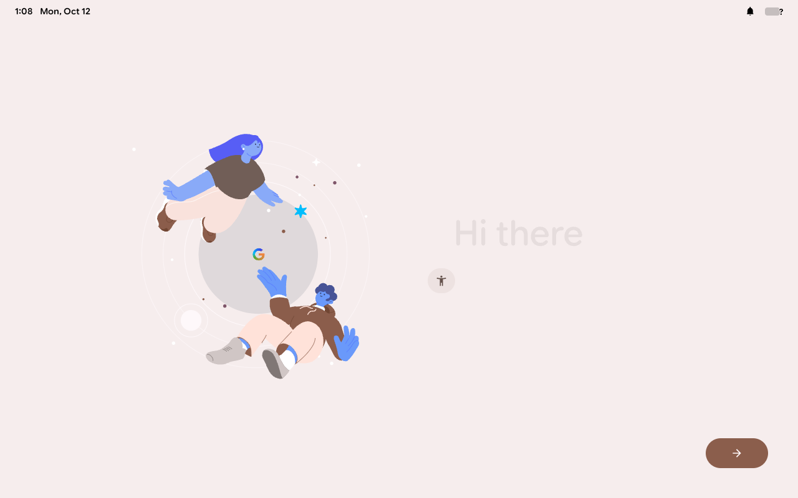

# Windows x86_64 VM research

This is an experimental QEMU project, not a ready-to-use Googlebook VM download or a validated Windows package.

**Verified milestone:** the Googlebook “Hi there” setup screen rendered on the Linux/QEMU Work host using software graphics. Setup completion, the desktop and Windows/WHPX execution remain unverified. Cold startup is slow under TCG CPU emulation.



The intended workflow downloads the official Lenovo Ruby recovery locally, preserves Google's system partitions, and assembles a virtual-device compatibility environment using Android Cuttlefish. No Google recovery or assembled Googlebook image is distributed here.

## First hardware probe

`probe_virtual_gpu.py` builds a small BusyBox initramfs from locally extracted Cuttlefish x86 files and boots its matching kernel under QEMU TCG. It attaches no disks and enables no network. It tests registration of the virtio GPU display and render devices in sysfs; it does not test Android, rendered frames, 3D acceleration, or Windows WHPX.

Tested on the Linux Work host with QEMU 11: Cuttlefish build 16373615, kernel `6.12.74-android16-6-g3ec022196c4e-ab15076761`. The matching virtio GPU initialized and registered `card0`, `card0-Virtual-1`, and `renderD128`. Android kernels rely on userspace device management; this minimal initramfs does not create DRM device nodes automatically.

```sh
python3 vm/probe_virtual_gpu.py \
  --donor /path/to/extracted/cuttlefish-x86 \
  --busybox /path/to/static/busybox \
  --qemu /path/to/qemu-system-x86_64 \
  --work /path/to/new/probe-directory
```

Use `--qemu-data` and `--bios` if QEMU's firmware is not installed at its default paths. The serial transcript is saved as `serial.log`. The donor layout currently follows the retained research extraction, including `boot/kernel` and `vendor_boot/fragment-0-platform-files/lib/modules/`.

## Remaining gates

- Ruby's kernel is Android 17 / Linux 6.18.21. The retained Cuttlefish x86 donor is Android 16 / Linux 6.12.74. Its virtual drivers cannot be loaded into Ruby's kernel because their symbol ABI differs.
- Test Ruby userspace with a matching virtual kernel/module set, or obtain/build virtual drivers matching Ruby's kernel. The successful driver probe does not establish Googlebook compatibility with the donor kernel.
- Assemble and validate allocator, mapper, compositor, EGL, virtual networking and software security components.
- Boot to the actual Googlebook desktop and test input, graphics, networking and persistence.
- Package local preparation, start, log collection and reset for Windows, then validate WHPX on a Windows host. Hardware accelerated virtual graphics is unproven.

Credits: [gbos-vm](https://github.com/skylartaylor/gbos-vm) provides the vendor-grafting model; Android Cuttlefish provides virtual-device components. See the project README for upstream licenses and credits.

## Googlebook userspace experiment

A subsequent local Linux/QEMU test used the matching Cuttlefish kernel/early modules and the existing private Ruby compatibility view. It reached Android second-stage init, mounted the system, activated system APEX packages, and started Zygote and SurfaceFlinger. During a 125-second observation, SurfaceFlinger repeatedly received SIGABRT and restarted Zygote. No working desktop or rendered frame was established.

The physical HP profile also attempted to load Ruby Intel modules into the Cuttlefish kernel, producing expected ABI rejection. A separate VM init profile removes its explicit `insmod` commands. Automatic vendor module discovery and virtual graphics services still need adaptation.

`prepare_android_initrd.py` assembles a private ramdisk from local donor and Ruby extractions, with a caller-supplied compatibility fstab. It also emits a project-owned VM init sidecar. Install that sidecar into a **new local compatibility partition/view** and use `androidboot.init_rc=/oem/init.gbrunch-vm.rc`; a file placed in the initial ramdisk root is lost when Android switches root. This tool does not build the compatibility partition or vendor environment by itself.

`run_local_probe.py` runs a prepared QCOW2 view with disposable writes, captures serial output and a command manifest, and limits runtime. It uses TCG for Linux development. It does not implement Windows WHPX or a graphical user launcher yet. Inputs must be regular local files; never provide host block devices. A normal QEMU exit or timeout does not indicate boot success.

The private Google-derived ramdisks, recovery views and raw transcripts remain in the Work environment, outside this repository.

The separate compatibility-partition init profile was subsequently tested. Android read `/oem/init.gbrunch-vm.rc` successfully. Delayed serial logcat captured the graphics abort: ANGLE's Vulkan initialization fails, `eglInitialize` returns `EGL_NOT_INITIALIZED`, and SurfaceFlinger aborts with `no suitable EGLConfig found`. This establishes a userspace graphics failure in this profile; it does not establish that other startup dependencies are resolved. The next experiment must supply a compatible virtual/software rendering stack rather than reuse the Intel Vulkan path.

## Software-rendering progress

The local Cuttlefish donor contains `vulkan.pastel.so` (SwiftShader) in `com.google.cf.vulkan.apex`. Its extracted SHA-256 is `5232e4829d8e6bba2d81cc0ff64d227504601090d2ac7b9fa105536e38c680a3`.

The experiments established these separate results:

| Local profile | Observed result |
| --- | --- |
| Ruby Intel Vulkan with virtual GPU | ANGLE Vulkan initialization failed; SurfaceFlinger aborted. |
| Software Vulkan via runtime file overlay | Required a scoped SELinux mount permission; library loading still failed. |
| Software Vulkan in a private vendor view | ANGLE initialized SwiftShader and detected 1280×800, then native texture import failed. |
| Software Vulkan plus Cuttlefish allocator/mapper/gralloc and matching DMA heap | During 115 seconds, neither the preceding EGL-config failure nor texture-import abort appeared. Googlebook's boot animation started; Zygote was preloading classes. A desktop was not verified. |

The allocation experiment selected `ro.hardware.vulkan=pastel`, included the matching donor `system_heap.ko`, and added its dependency entry to the ramdisk. `prepare_android_initrd.py --with-system-heap` reproduces that ramdisk component. It still requires a separately prepared compatibility/vendor view.

`experiments/prepare_pastel_overlay.py` preserves the **unsuccessful runtime-overlay approach** for research and reproduces its local assembly. It is not the working allocation profile or a VM installer. It validates the retained donor Vulkan APEX hash and verifies image file readback. Original input images are never overwritten.

`run_local_probe.py --capture-frame` attempts a QMP screenshot and saves failures separately. The initial minimal development QEMU lacked the `screendump` command; a display-enabled build is required for visual validation. A boot-animation log alone is not evidence of a visible desktop.

`graft_vendor_files.py` provides the local EROFS graft step used by these experiments. It copies the input to a new output, imports original inode permissions/ownership/labels, preserves the compact root's metadata, checks the filesystem, and verifies each replacement by hash readback. A JSON mapping names each vendor path and local replacement file; a new path can specify an existing `metadata_from` path. Generated vendor images are private local outputs. The virtual disk's partition allocation must also be rebuilt when the result grows beyond the old partition size; this helper does not perform that step.

The graft helper was verified against the retained private vendor using a real build-property replacement and filesystem/readback checks. The wider graphics conversion remains a research assembly, not a complete public VM builder.

The display-enabled development QEMU was rebuilt with `--enable-pixman --enable-vnc`. QMP screenshot capture then worked, but an early 1280×800 frame was black. That longer test ended with SIGKILL in the memory-constrained Work environment and is inconclusive for desktop startup. The runner accepts `--memory-mb` to control guest memory independently of the runtime limit.

A later 300-second run with 3 GB guest RAM completed without a host OOM kill. Android reached `system_server`, but the final virtual display was black and SurfaceFlinger queries timed out. A separate run replacing the compositor and atom reporter with matching Cuttlefish components still reached a display startup watchdog: `DisplayManagerService.onBootPhase` waited for its display lock, then the watchdog killed and restarted `system_server`. These runs do **not** establish a usable desktop. Native thread-stack diagnostics are the next investigation; replacing more components without identifying the blocking call would obscure the cause.

## Native graphics diagnostics

`diagnostics/capture_native_stacks.sh` is an Android guest script for a locally prepared research view. It waits for startup, reports the software-sync and DMA-heap device nodes, resolves graphics process IDs, and attempts bounded native backtraces and per-thread kernel wait information. It is not a host script or a complete diagnostic installer.

The first root/init-domain helper failed because Android toolbox commands transitioned into the restricted `toolbox` domain. A shell-domain service with its owned script labeled `shell_data_file` resolved the process IDs. Backtraces and kernel stacks were then denied by the shell domain’s signal/tracing capability rules. A private follow-up experiment adds the audited `shell shell:capability` permissions `kill` and `sys_ptrace`, plus process signal checks/signaling restricted to `surfaceflinger`, `hal_graphics_composer_default` and `bootanim` to its local vendor policy. This debugging policy is **not** part of the normal laptop or VM preparation flow; the published helper does not apply policy changes. Further attempts encountered the crash-reporting interception socket and per-thread stack DAC checks. Those are diagnostic access failures, separate from the original display stall. Keep enforcing enabled and inspect actual denials. A PID or a backtrace does not establish desktop success.

The native dump subsequently succeeded after scoped VM-only crash-reporting socket/descriptor permissions and stack-read access. It showed RenderEngine waiting in SwiftShader `vk::Device::waitForFences` during `primeShaderCache`, while a software-renderer thread was compiling LLVM shaders. This is a captured startup workload, not proof of a permanent deadlock. The compositor threads in that capture were waiting in their service/event loops.

A follow-up disabled optional startup shader prewarming through the owned compatibility init profile (`service.sf.prime_shader_cache=0`), confirmed by guest property readback. `prepare_android_initrd.py --skip-shader-prewarm` emits that experimental setting into its VM sidecar. The original system remains untouched. That experiment exposed a boot-animation crash at `[anon:swiftshader_jit]`, with matching `bootanim bootanim:process execmem` denials. A separate local test grants that single permission for this software-rendering profile. A usable desktop and Windows/WHPX remain unverified.

A subsequent 300-second repeat with shader prewarming disabled and the single boot-animation executable-memory permission completed without a host OOM kill. The final 1280×800 QMP screenshot visibly showed the Googlebook boot animation. No boot-animation fatal signal or display watchdog appeared in the retained transcript during this repeat. **Setup, the desktop, input, networking and Windows remain unverified.** `experiments/software-profile.json` records the donor component hashes and profile settings; it is a research manifest, not a complete image builder. Package initialization was still underway, including a `cppreopt did not finish` timeout and continued copies from the official preoptimization partition. That suggests a longer or accelerated first-boot test is needed; it does not establish that slow emulation is the sole remaining issue.

## Longer boot and Windows launcher work

`diagnostics/boot_status.sh` collects bounded display queries, package/bootstrap logs, userdata usage, and `sys.cppreopt`/boot-completion state. A locally installed shell-domain service must be able to read it: set the owned script mode to `0644` and label to `shell_data_file`. It is not automatically installed by the public image helpers.

The longer first-boot investigation also found that QEMU temporary snapshot writes filled the Work filesystem while Android copied preoptimized application files. That test is inconclusive. `run_local_probe.py --scratch-directory /path/to/disk-backed/scratch` now selects the temporary-write location explicitly, checks available space before launch (default minimum 1024 MB, adjustable with `--minimum-scratch-mb`), and records space before/after. The minimum is a guard, not a capacity estimate: allow several GB for a first boot. RAM-backed scratch storage consumes host memory. Original recovery downloads and extractions remain retained separately.

[Windows launcher research](windows/README.md) now provides a manifest generator and a file-only QEMU launcher, disposable trials, optional separate persistent userdata, hash checks and dated logs. Its guard tests and a real QCOW2 dry run were checked on Linux. **Windows/WHPX execution remains untested**, and the local download/build preparation flow is still pending. These developer tools are not the nontechnical VM package.

Direct inspection of the official inactive-slot filesystem found **49 AICore preload files totaling 4,277,595,477 bytes**. The retained experimental userdata partition is about 4.3 GB, which cannot hold those models plus Android data and preoptimization output. A fuller VM needs larger userdata and several GB of host space for first-boot writes.

`prepare_android_initrd.py --skip-ai-preloads` provides a separate **minimal VM experiment**: it replaces the preoptimization init import in the owned compatibility sidecar, still runs the original application preoptimization-copy job, and omits the AICore preload-copy step. Install the emitted `.vm-preopts.rc` as `/oem/vm-cppreopts.rc`. Original system and model bytes remain unchanged in the recovery. Local AI behavior is unverified and this option is not the default. It does not resize userdata or complete the VM image build.

`experiments/prepare_software_vendor.py` assembles the graphics/vendor graft from the locally extracted Cuttlefish donor and a locally built Ruby compatibility vendor. It checks the pinned component hashes, emits a private file mapping, grants the scoped boot-animation executable-memory permission, and invokes the EROFS metadata/readback checks. Kernel/ramdisk preparation, compatibility-partition installation and virtual-disk partition allocation remain separate steps. Do not redistribute its Google-derived outputs.

The software-vendor helper was subsequently exercised against the retained local compatibility vendor and pinned donor. Its complete extraction/hash, policy graft, EROFS check and replacement readback stages passed; original vendor input SHA-256 remained unchanged. The output is a locally generated graphics vendor, not a standalone VM image.

The minimal/no-AICore-profile ten-minute run completed without a host OOM kill or exhausted scratch storage. The normal preoptimization copy exited successfully and `sys.cppreopt` became `finished`; ART app compilation continued and `sys.boot_completed` remained unset. The final display still showed the boot animation, so setup and desktop remain unverified. A disk-only progress overlay was captured with CPUs paused, checked with `qemu-img check`, and retained privately for subsequent cached boot trials. This is disk state, not a RAM/suspend snapshot.

The cached trial subsequently started Setup Wizard and System UI, but both aborted in HWUI `VulkanManager::initialize()` on `queueProps[i].queueFamilyProperties.queueCount < kRequestedQueueCount`. This is a distinct app-renderer compatibility failure, not evidence that setup was visible. A new profile selects `debug.hwui.renderer=skiagl` before app startup, routing HWUI through OpenGL/ANGLE over the existing software Vulkan stack. `prepare_android_initrd.py --software-hwui` reproduces that owned-init setting; direct Vulkan apps remain unverified. The current trial retains enforcing and the original system images.

## Verified setup-screen profile

The cached software-rendering profile used `debug.hwui.renderer=skiagl` to avoid the app HWUI Vulkan queue-count assertion. With matching donor ZRAM modules, virtual input devices and an emulation timeout multiplier, a ten-minute run captured the actual **Hi there** screen. The input service recognized the QEMU virtio keyboard and tablet; clicking through setup has not been validated. Bluetooth still reports hardware initialization failures. Networking is disabled. Local AI model preloading is omitted, and local AI, audio, camera and direct Vulkan apps remain unverified.

Relevant helper options are `--with-system-heap --with-zram --skip-shader-prewarm --software-hwui --skip-ai-preloads --timeout-multiplier 10`. Timeout scaling is an experiment for slow TCG, not proof that all startup delays are solved and not a default recommendation for hardware acceleration. The matching `zsmalloc.ko` and `zram.ko` loaded successfully; the guest subsequently reported about 3.25 GiB of swap. The owned compatibility partition must still receive the emitted init/preoptimization sidecars.

`run_local_probe.py --virtual-input` adds the candidate keyboard/tablet. `--retain-writes --qemu-img /path/to/qemu-img` keeps writes in a **new separate overlay in scratch storage**, so another trial can use that overlay as its local base. The original input is not opened for guest writes. Existing retained overlays are never overwritten; use a fresh work-directory name. Keep backing files available and do not share guest userdata. A retained overlay is disk state, not a saved RAM session.

The shorter five-minute cached retry still showed the boot logo. This establishes a rendered welcome-screen milestone, not a repeatable fast desktop boot or a finished Windows installer. The immediate remaining work is interactive setup validation, virtual networking, a complete local preparation pipeline, and tests on a real Windows host with WHPX.

### R4 startup diagnosis (October 25 follow-up)

A later readback of the cached R4 trial changes the earlier interpretation: Android reached `sys.boot_completed=1`, and WindowManager focused `DesktopWelcomeActivity`. SurfaceFlinger's dump still contained an opaque `BootAnimation` layer above the setup buffers. Thus the logo screenshot did not establish a framework deadlock. The early serial diagnostic sampled startup before these later milestones. [Sanitized evidence](../docs/validation/r4-software-startup.json) records the distinction.

`prepare_android_initrd.py --skip-boot-animation` adds an optional VM-only setting to the owned compatibility init sidecar. It leaves the original Google system partitions and normal HP boot path unchanged. Use the corresponding sidecar in the private compatibility filesystem; label init `.rc` files `vendor_file`, not `shell_data_file`. This is a diagnostic workaround for a covering animation, not proof of a complete VM product.

`diagnostics/classify_boot.py --log SERIAL --properties SAVED_GETPROP --output RESULT` can recognize completion from a saved property snapshot even when the earlier serial sample missed it. Graphical success remains a separate visual check. The periodic status helper now records boot-animation state as well as framework startup state.

The follow-up with boot animation skipped visibly reached the R4 welcome screen (greeting, accessibility control and Next button), with `sys.boot_completed=1` and the welcome activity focused. This establishes graphical welcome for this particular cached TCG trial. It does not establish a completed setup, working networking, Windows acceleration, or full Android boot from the one-partition layout. The precise reason the original animation did not exit is still unverified; the workaround bypasses it rather than rewriting Google's animation.
